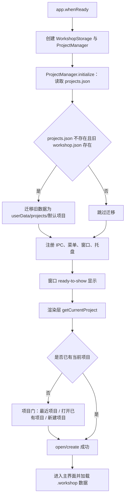
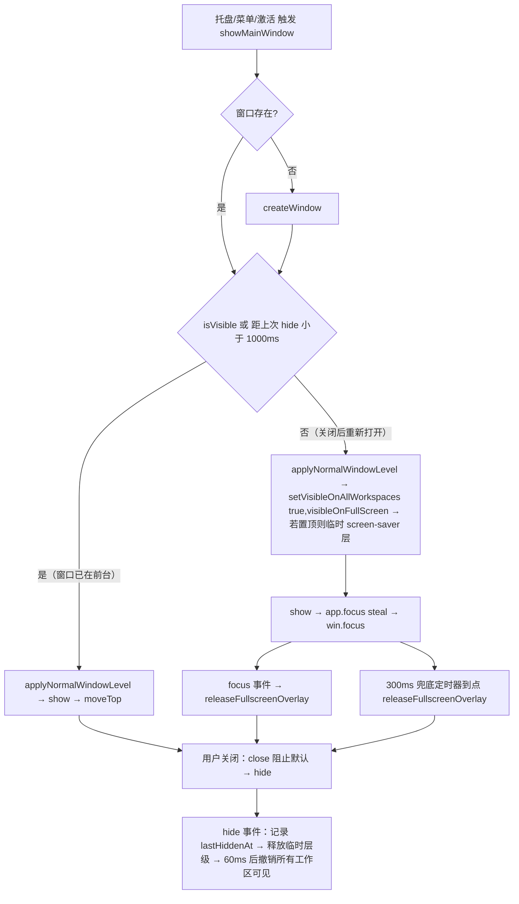

# 1. 产品与技术架构

### 1.1 产品定位

创作工坊面向小说作者、世界观构建者与桌游设定作者，用于离线生成和整理人族、精灵族的人名、地名、官职与绰号。应用不依赖远程业务页面、AI 服务或账号体系。

当前版本为 **1.1.0**（`package.json` → `version`）。

### 1.2 进程结构

| 层              | 目录 / 文件                               | 职责                                                                       |
| --------------- | ----------------------------------------- | -------------------------------------------------------------------------- |
| Electron 主进程 | `electron/main.cts`                       | 创建窗口、托盘、应用菜单、安全策略、读取 `creationWorkshop` 配置并注册 IPC |
| 项目管理        | `electron/services/project-manager.cts`   | `userData/projects.json` 最近项目、打开/新建项目、VS Code 打开、旧数据迁移 |
| 项目数据服务    | `electron/services/workshop-storage.cts`  | 打开项目、读写 `.workshop` 分类文件、串行队列、级联规则、统计              |
| Markdown 读写   | `electron/services/workshop-markdown.cts` | 各类 Markdown 的解析与序列化、字段转义、容错读取、图谱快照                 |
| 预加载桥        | `electron/preload.cts`                    | 通过 `contextBridge` 暴露白名单 `window.workshop`                          |
| IPC 边界        | `electron/ipc/workshop-ipc.cts`           | 校验调用来源、处理项目/数据/剪贴板请求                                     |
| 渲染层          | `src/`                                    | React 界面、项目门与纯本地命名生成                                         |
| 打包脚本        | `scripts/`                                | 清理旧产物、打包后处理与安装脚本                                           |

渲染进程禁止直接访问 Node.js、文件系统与子进程；`nodeIntegration=false`、`contextIsolation=true`、`sandbox=true`（`electron/main.cts`）。

### 1.3 启动流程与项目门

应用启动后不自动打开上次项目：主进程初始化项目登记后创建窗口与托盘，窗口在 `ready-to-show` 时立即显示；渲染层查询「当前项目」，为空时展示项目门，由用户选择最近项目、打开已有项目或新建项目。

项目门行为（`src/components/ProjectGate.tsx`）：

- 最近项目列表来自 `userData/projects.json`，按 `lastOpenedAt` 倒序；不存在的项目目录在列表查询时被过滤（`ProjectManager.listRecent`）。
- 「打开已有项目…」调用系统目录选择框，只列目录；所选目录必须包含 `.workshop` 数据目录，否则提示「该目录不是创作工坊项目（缺少 .workshop 数据目录）」。
- 「新建项目」先选择存放位置，再输入项目名称；名称不能为空、不能以 `.` 开头、不能包含 `\ / : * ? " < > |` 或控制字符，长度不超过 **60** 字符（`MAX_PROJECT_NAME_LENGTH`，渲染层输入框同为 `maxLength=60`）。
- 新建时目标目录不能已存在；成功后创建 `<parentDir>/<name>/.workshop` 并写入各分类文件。
- 设置页「切换项目」只回到项目门（渲染层将当前项目置空），不关闭主进程内的数据服务；再次打开项目时替换当前项目。

### 1.4 窗口行为

| 项目           | 值                 | 来源                                                                                      |
| -------------- | ------------------ | ----------------------------------------------------------------------------------------- |
| 窗口内容尺寸   | 800 × 600          | `package.json` → `creationWorkshop.window.width/height`                                   |
| 尺寸缺省回退   | 640 × 480          | `electron/main.cts`（配置缺省时）                                                         |
| 标题栏样式     | `hiddenInset`      | `package.json` → `creationWorkshop.window.titleBarStyle`                                  |
| 红绿灯位置     | `{ x: 12, y: 12 }` | `electron/main.cts` → `trafficLightPosition`                                              |
| 窗口类型       | `panel` 面板窗口   | `package.json` → `creationWorkshop.window.type`（非 darwin 不传）                         |
| 默认置顶       | 否                 | `creationWorkshop.window.alwaysOnTop`                                                     |
| 置顶层级       | `floating`         | `creationWorkshop.window.alwaysOnTopLevel`（仅置顶为真时生效）                            |
| Dock 图标      | 不显示             | `package.json` → `build.mac.extendInfo.LSUIElement`；`electron/main.cts` → `hideDockIcon` |
| 可调整尺寸     | 否                 | `electron/main.cts` → `resizable/maximizable/fullscreenable`                              |
| 使用内容尺寸   | 是                 | `electron/main.cts` → `useContentSize: true`                                              |
| 窗口背景色     | `#f5efe2`          | `electron/main.cts` → `backgroundColor`                                                   |
| 应用名         | 创作工坊           | `package.json` → `productName`；`app.setName`                                             |
| 拖拽标题栏高度 | 32 px              | `src/App.css` → `.desktop-titlebar`                                                       |

应用加载 `dist/index.html`；开发调试可通过 `VITE_DEV_SERVER_URL` 指向本地 Vite 服务，并在该模式下自动打开独立 DevTools。

启动时窗口由 `mainWindow.once('ready-to-show', showMainWindow)` 显示，用户首先看到项目门。主窗口系统关闭按钮只隐藏窗口（`close` 事件阻止默认并 `hide()`），应用继续由托盘驻留；托盘左键与右键菜单「打开主界面」、应用菜单「窗口 → 显示主界面」重新打开。托盘右键菜单提供「打开主界面」和「退出创作工坊」。应用无 Dock 图标，因此 `activate`（点击 Dock）不是常规入口。

主窗口是 macOS **`panel` 面板窗口**（`type: 'panel'`）：层级高于普通窗口、跟随当前活跃 Space（含全屏 Space），且 `canBecomeMainWindow = false`，
不会把用户从其它应用的全屏界面里拉回桌面；`NSPanel` + `titled` 样式使窗口仍可成为 key window，正常接收键盘输入与中文输入法。
窗口默认不置顶（`alwaysOnTop: false`）；置顶只在配置为真时设置，层级取 `alwaysOnTopLevel`（`floating`），且配置为假时**不调用任何 `setAlwaysOnTop`**，避免残留层级把窗口长期压在最上层。

`showMainWindow()`（`electron/main.cts`）是唯一的显示/抢焦点出口，流程如下：

要点：

- **在当前桌面打开**：窗口隐藏后于 `SPACE_SETTLE_DELAY_MS = 60ms` 撤销「所有工作区可见」（`releaseFromAllSpaces`），撤销发生在窗口不可见之后，不会闪动；由于是 panel，下一次打开按当前活跃 Space 落位，不会被系统拉回上次/首次打开的桌面。旧版「60ms 后重新绑定桌面 + `spaceBindTimer`」逻辑已整体删除。
- **全屏下可打开**：重新打开时启用 `setVisibleOnAllWorkspaces(true, { visibleOnFullScreen: true, skipTransformProcessType: true })`；置顶开启时再临时抬到 `FULLSCREEN_OVERLAY_LEVEL = 'screen-saver'`，拿到焦点或 `LEVEL_RESTORE_TIMEOUT_MS = 300ms` 兜底后恢复（`focus` 事件、`hide`、`closed` 均会清理，`before-quit` 清理定时器）。置顶关闭时**不抬层**，不会压住状态栏/Dock。
- **重新打开判定**：`REVEAL_MIN_INTERVAL_MS = 1000`（`electron/main.cts`）——窗口不可见，或距上次 `hide` 超过 1 秒，才视为「关闭后重新打开」并抢一次焦点；窗口已在前台再次点托盘只 `show`/`moveTop`，不抢焦点、不叠加层级。
- **不显示 Dock 图标**：打包后 `Info.plist` 声明 `LSUIElement = true`（`package.json` → `build.mac.extendInfo`），系统层面即无可激活 Dock 图标；运行期 `whenReady` 最先调用 `hideDockIcon()`（`app.dock?.isVisible()` 时 `app.dock.hide()`）作为开发态兜底，且只在启动时调用一次（规避 Electron「1 秒内重复 `dock.hide()` 无效」的已知问题），窗口再次显示不会让 Dock 图标回来。因无 Dock 图标，重新打开时在 darwin 上先 `app.focus({ steal: true })` 再 `win.focus()`，确保窗口成为 key window。

应用在 `Info.plist` 中显式声明 `NSHighResolutionCapable=true` 与 `LSUIElement=true`，页面缩放固定为 1，并启用字体平滑以适配 Retina/HiDPI 显示。默认字体依次尝试思源宋体、仿宋、宋体，均不存在时回退系统默认字体。

### 1.5 安全与导航

- 仅接受来自应用 `file://` 页面或本机开发服务器（`http://127.0.0.1:` / `http://localhost:`）的 IPC 调用；其它来源直接抛错（`electron/ipc/workshop-ipc.cts` → `trustedSender`）。
- 禁止创建新窗口、嵌入 Webview 与页面导航。
- 所有媒体权限请求默认拒绝。
- 页面使用 Content Security Policy，只允许本地脚本、样式、图片与数据 URL。
- 不加载远程字体或图标资源。
- 渲染层不能指定任意保存路径；项目路径来自系统目录选择对话框或项目登记文件。

### 1.6 配置项（`package.json` → `creationWorkshop`）

| 配置键                       | 默认值 / 实际值                | 作用                             | 读取位置                                                   |
| ---------------------------- | ------------------------------ | -------------------------------- | ---------------------------------------------------------- |
| `project.dataDirName`        | `.workshop`                    | 项目内数据目录名                 | `electron/main.cts` → `ProjectManager` / `WorkshopStorage` |
| `project.registryFileName`   | `projects.json`                | `userData` 下项目登记文件名      | `electron/main.cts` → `ProjectManager`                     |
| `project.legacyDataFileName` | `workshop.json`                | 旧版单 JSON 数据文件名（迁移源） | `electron/main.cts` → `ProjectManager`                     |
| `project.maxRecentProjects`  | `10`                           | 最近项目数量上限                 | `electron/main.cts` → `ProjectManager`                     |
| `window.width` / `height`    | `800` / `600`                  | 窗口内容尺寸                     | `electron/main.cts`                                        |
| `window.titleBarStyle`       | `hiddenInset`                  | 标题栏样式                       | `electron/main.cts`                                        |
| `window.type`                | `panel`                        | 窗口类型（仅 macOS 生效）        | `electron/main.cts`                                        |
| `window.alwaysOnTopLevel`    | `floating`                     | 置顶时的窗口层级（仅置顶为真时） | `electron/main.cts`                                        |
| `window.alwaysOnTop`         | `false`                        | 是否默认置顶                     | `electron/main.cts`                                        |
| `tray.iconFile`              | `assets/imgs/trayTemplate.png` | 托盘模板图标                     | `electron/main.cts`                                        |

四个 `project.*` 配置项缺省时回退到上表默认值；空字符串视为未配置。旧版 `creationWorkshop.storage.fileName` 已不存在。
`window.*` 缺省时回退到 `electron/main.cts` 中集中定义的 `DEFAULT_*` 常量；`window.type` 仅 darwin 生效，其它平台不传 `type`。

### 1.7 数据位置

- 项目登记：`<userData>/projects.json`（`ProjectManager` 启动日志输出绝对路径）。
- 项目数据：用户选择的项目目录下 `.workshop/` 内的六个 Markdown 文件（详见 §7）。
- 迁移来源：`<userData>/workshop.json`（仅首次升级读取一次，迁移后保留原文件）。
- `userData` 由 Electron 按应用名与平台确定；渲染层不感知具体绝对路径。

### 1.8 资源与目录

- 应用图标：`assets/imgs/app-icon.png`、`assets/imgs/app-icon.icns`。
- 托盘模板图标：`assets/imgs/trayTemplate.png`、`trayTemplate@2x.png`、`trayTemplate@3x.png`。
- 应用内 SVG 图标通过 `lucide-react` 组件使用，不新增手写 SVG 标签。
- 图标资源仍随安装包分发：`package.json` → `build.files` 显式包含 `assets/imgs/trayTemplate*.png`。
- README 只包含应用图标与一句概述，功能细节以本 PRD 为准。
