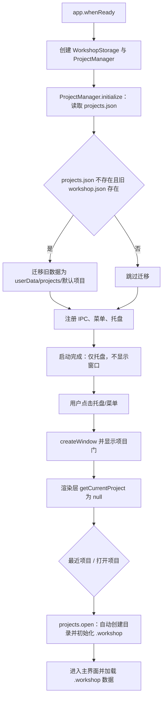
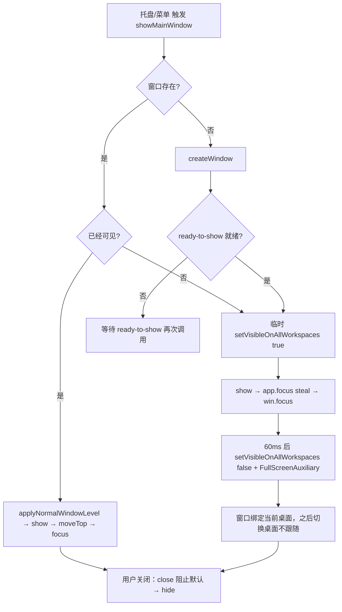

# 1. 产品与技术架构

### 1.1 产品定位

创作工坊面向小说作者、世界观构建者与桌游设定作者，用于离线生成和整理人族、精灵族的人名、地名、官职与绰号。应用不依赖远程业务页面、AI 服务或账号体系。

当前版本为 **1.5.0**（`package.json` → `version`）。

### 1.2 进程结构

| 层              | 目录 / 文件                               | 职责                                                                                |
| --------------- | ----------------------------------------- | ----------------------------------------------------------------------------------- |
| Electron 主进程 | `electron/main.cts`                       | 创建窗口、托盘、应用菜单、安全策略、读取 `creationWorkshop` 配置并注册 IPC          |
| 项目管理        | `electron/services/project-manager.cts`   | `userData/projects.json` 最近项目、打开项目（自动初始化）、VS Code 打开、旧数据迁移 |
| 项目数据服务    | `electron/services/workshop-storage.cts`  | 打开项目、读写 `.workshop` 分类文件、串行队列、级联规则、统计                       |
| Markdown 读写   | `electron/services/workshop-markdown.cts` | 各类 Markdown 的解析与序列化、字段转义、容错读取、图谱快照                          |
| 预加载桥        | `electron/preload.cts`                    | 通过 `contextBridge` 暴露白名单 `window.workshop`                                   |
| IPC 边界        | `electron/ipc/workshop-ipc.cts`           | 校验调用来源、处理项目/数据/剪贴板请求                                              |
| 渲染层          | `src/`                                    | React 界面、项目门与纯本地命名生成                                                  |
| 打包脚本        | `scripts/`                                | 清理旧产物、打包后处理与安装脚本                                                    |

渲染进程禁止直接访问 Node.js、文件系统与子进程；`nodeIntegration=false`、`contextIsolation=true`、`sandbox=true`（`electron/main.cts`）。

### 1.3 启动流程与项目门

应用启动时**只驻留系统托盘，不创建也不显示主窗口**。主进程初始化项目登记、注册 IPC、菜单与托盘后结束启动流程；用户点击托盘图标、托盘菜单「打开主界面」或应用菜单「窗口 → 显示主界面」时才创建主窗口并显示项目门。

项目门行为（`src/components/ProjectGate.tsx`）：

- 项目门不提供「新建项目」「刷新」按钮；顶部「打开项目」按钮调用系统目录选择框（允许在对话框内新建目录）。
- 最近项目列表来自 `userData/projects.json`，按 `lastOpenedAt` 倒序，因此**上次打开（含上次启动后打开）的项目固定排第一**，并显示「上次」TAG；目录已不存在的条目在列表查询时被过滤（`ProjectManager.listRecent`）。
- **项目展示名优先读取项目根目录 `README.md` 的第一行**（去掉 `#` 前缀）；没有 README 或首行为空时回退登记名称 / 目录名。启动查询最近项目与打开项目时都会重新读取。
- 「打开项目」与点击最近项目都调用 `projects.open(path)`：目录不存在时自动创建；目录存在但没有 `.workshop` 时自动初始化；已有 `.workshop` 时直接打开（`electron/services/project-manager.cts`）。
- **空目录初始化**：目录原本为空（或不存在、刚被创建）时，除 `.workshop` 外还自动创建 `README.md`（首行 `# <目录名>`）与 `第一卷/第一章.md`；已有内容或已有 `.workshop` 的目录不会补写这两个文件。
- `projects.create({ parentDir, name })` IPC 仍保留以兼容旧调用，但项目门不再提供新建入口；日常新建项目通过「打开项目」选择一个新目录完成。
- 设置页「切换项目」只回到项目门（渲染层将当前项目置空），不关闭主进程内的数据服务；再次打开项目时替换当前项目。

### 1.4 窗口行为

| 项目           | 值                         | 来源                                                                                      |
| -------------- | -------------------------- | ----------------------------------------------------------------------------------------- |
| 窗口内容尺寸   | 800 × 600                  | `package.json` → `creationWorkshop.window.width/height`                                   |
| 尺寸缺省回退   | 800 × 600                  | `electron/main.cts`（配置缺省时）                                                         |
| 标题栏样式     | `hiddenInset`              | `package.json` → `creationWorkshop.window.titleBarStyle`                                  |
| 红绿灯位置     | `{ x: 12, y: 12 }`         | `electron/main.cts` → `trafficLightPosition`                                              |
| 窗口类型       | 普通独立窗口（非 panel）   | `electron/main.cts` 不传 `type`                                                           |
| 默认置顶       | 否                         | `creationWorkshop.window.alwaysOnTop`                                                     |
| 置顶层级       | `floating`                 | `creationWorkshop.window.alwaysOnTopLevel`（仅置顶为真时生效）                            |
| 桌面归属       | 打开时所在桌面；切换不跟随 | `electron/main.cts` → `bindWindowToCurrentDesktop`                                        |
| Dock 图标      | 不显示                     | `package.json` → `build.mac.extendInfo.LSUIElement`；`electron/main.cts` → `hideDockIcon` |
| 可调整尺寸     | 否                         | `electron/main.cts` → `resizable/maximizable/fullscreenable`                              |
| 使用内容尺寸   | 是                         | `electron/main.cts` → `useContentSize: true`                                              |
| 窗口背景色     | `#f5efe2`                  | `electron/main.cts` → `backgroundColor`                                                   |
| 应用名         | 创作工坊                   | `package.json` → `productName`；`app.setName`                                             |
| 拖拽标题栏高度 | 32 px                      | `src/App.css` → `.desktop-titlebar`                                                       |

应用加载 `dist/index.html`；开发调试可通过 `VITE_DEV_SERVER_URL` 指向本地 Vite 服务，并在该模式下自动打开独立 DevTools。

启动完成后没有窗口；用户首次点击托盘时 `createWindow` 创建窗口，`ready-to-show` 后再调用 `showMainWindow()`，因此不会闪白屏。主窗口系统关闭按钮只隐藏窗口（`close` 事件阻止默认并 `hide()`），应用继续由托盘驻留；托盘左键与右键菜单「打开主界面」、应用菜单「窗口 → 显示主界面」重新打开。托盘右键菜单提供「打开主界面」和「退出创作工坊」。应用无 Dock 图标，因此 `activate`（点击 Dock）不是常规入口。

主窗口是**普通独立窗口**（不是 macOS `panel`）：打开后绑定在显示时所在的桌面，**切换桌面时不会自动跟随**；关闭后从另一个桌面重新打开时，先临时加入所有桌面、显示聚焦后再绑定当前桌面，因此会出现在新桌面而不是旧桌面。窗口始终不置顶（`alwaysOnTop: false` 时不会调用任何 `setAlwaysOnTop`）。

`showMainWindow()`（`electron/main.cts`）是唯一的显示 / 抢焦点出口：

要点：

- **独立窗口模式**：窗口创建、获得焦点与重新显示后都调用
  `setVisibleOnAllWorkspaces(false, { visibleOnFullScreen: true, skipTransformProcessType: true })`
  （`electron/main.cts` → `WINDOW_COLLECTION_BEHAVIOR` / `bindWindowToCurrentDesktop`），即「带全屏辅助、但不加入所有桌面」：可以浮在当前桌面的全屏应用之上，同时**不会跟随桌面切换**。
- **重新打开落在当前桌面**：窗口原本隐藏时先临时 `setVisibleOnAllWorkspaces(true, …)`，`show()` 并聚焦后在 `SPACE_BIND_DELAY_MS = 60ms` 绑定当前桌面；窗口已可见时只 `show` / `moveTop` / `focus`，不改变桌面归属。
- **不置顶**：配置 `alwaysOnTop` 为 `false`（默认）时不会调用 `setAlwaysOnTop`，窗口不压住其它应用，也不会长期悬浮在最上层。
- **不显示 Dock 图标**：打包后 `Info.plist` 声明 `LSUIElement = true`（`package.json` → `build.mac.extendInfo`），系统层面即无可激活 Dock 图标；运行期 `whenReady` 最先调用 `hideDockIcon()`（`app.dock?.isVisible()` 时 `app.dock.hide()`）作为开发态兜底，且只在启动时调用一次（规避 Electron「1 秒内重复 `dock.hide()` 无效」的已知问题），窗口再次显示不会让 Dock 图标回来。因无 Dock 图标，重新打开时在 darwin 上先 `app.focus({ steal: true })` 再 `win.focus()`，确保窗口成为 key window。
- **规则设置为模态子窗口**：主界面点击「规则设置」通过 `rules:open` 打开独立 `BrowserWindow`（`parent` 为主窗口、`modal: true`，宽高为主窗口内容尺寸的 80%（主窗口 800 × 600 时为 640 × 480）、不可移动、打开后自动居中），而不是在页面内向下展开或使用 HTML 弹层；子窗口关闭不影响主窗口。

应用在 `Info.plist` 中显式声明 `NSHighResolutionCapable=true` 与 `LSUIElement=true`，页面缩放固定为 1，并启用字体平滑以适配 Retina/HiDPI 显示。默认字体依次尝试思源宋体、仿宋、宋体，均不存在时回退系统默认字体。

### 1.5 安全与导航

- 仅接受来自应用 `file://` 页面或本机开发服务器（`http://127.0.0.1:` / `http://localhost:`）的 IPC 调用；其它来源直接抛错（`electron/ipc/workshop-ipc.cts` → `trustedSender`）。
- 禁止创建新窗口、嵌入 Webview 与页面导航。
- 所有媒体权限请求默认拒绝。
- 页面使用 Content Security Policy，只允许本地脚本、样式、图片与数据 URL。
- 不加载远程字体或图标资源。
- 渲染层不能指定任意保存路径；项目路径来自系统目录选择对话框或项目登记文件。

### 1.6 配置项（`package.json` → `creationWorkshop`）

| 配置键                       | 默认值 / 实际值                | 作用                             | 读取位置                                                   |
| ---------------------------- | ------------------------------ | -------------------------------- | ---------------------------------------------------------- |
| `project.dataDirName`        | `.workshop`                    | 项目内数据目录名                 | `electron/main.cts` → `ProjectManager` / `WorkshopStorage` |
| `project.registryFileName`   | `projects.json`                | `userData` 下项目登记文件名      | `electron/main.cts` → `ProjectManager`                     |
| `project.legacyDataFileName` | `workshop.json`                | 旧版单 JSON 数据文件名（迁移源） | `electron/main.cts` → `ProjectManager`                     |
| `project.maxRecentProjects`  | `10`                           | 最近项目数量上限                 | `electron/main.cts` → `ProjectManager`                     |
| `window.width` / `height`    | `800` / `600`                  | 窗口内容尺寸                     | `electron/main.cts`                                        |
| `window.titleBarStyle`       | `hiddenInset`                  | 标题栏样式                       | `electron/main.cts`                                        |
| `window.alwaysOnTopLevel`    | `floating`                     | 置顶时的窗口层级（仅置顶为真时） | `electron/main.cts`                                        |
| `window.alwaysOnTop`         | `false`                        | 是否默认置顶                     | `electron/main.cts`                                        |
| `tray.iconFile`              | `assets/imgs/trayTemplate.png` | 托盘模板图标                     | `electron/main.cts`                                        |

四个 `project.*` 配置项缺省时回退到上表默认值；空字符串视为未配置。旧版 `creationWorkshop.storage.fileName` 已不存在。
`window.*` 缺省时回退到 `electron/main.cts` 中集中定义的 `DEFAULT_*` 常量；窗口固定为普通独立窗口，不再读取 `window.type`。

### 1.7 数据位置

- 项目登记：`<userData>/projects.json`（`ProjectManager` 启动日志输出绝对路径）。
- 项目数据：用户选择的项目目录下 `.workshop/` 内的六个 Markdown 文件与自动生成的 `sheets.ini`（详见 §7）。
- 迁移来源：`<userData>/workshop.json`（仅首次升级读取一次，迁移后保留原文件）。
- `userData` 由 Electron 按应用名与平台确定；渲染层不感知具体绝对路径。

### 1.8 资源与目录

- 应用图标：`assets/imgs/app-icon.png`、`assets/imgs/app-icon.icns`。
- 托盘模板图标：`assets/imgs/trayTemplate.png`、`trayTemplate@2x.png`、`trayTemplate@3x.png`。
- 应用内 SVG 图标通过 `lucide-react` 组件使用，不新增手写 SVG 标签。
- 图标资源仍随安装包分发：`package.json` → `build.files` 显式包含 `assets/imgs/trayTemplate*.png`。
- README 只包含应用图标与一句概述，功能细节以本 PRD 为准。
