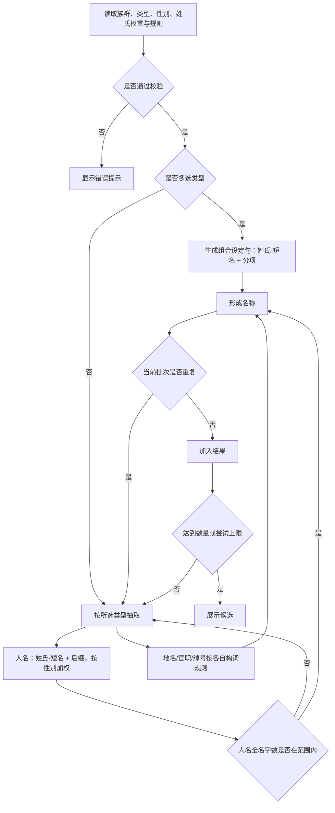

# 2. 命名生成

### 2.1 输入

生成页支持选择族群、名称类型、性别倾向、数量、短名块数、姓氏人口权重、人名后缀、绰号与职业/能力偏好。族群与名称类型均使用紧凑单选 Chip，生成过程完全在渲染进程本地完成。

| 参数         | 范围 / 默认值                    | 来源                                                      |
| ------------ | -------------------------------- | --------------------------------------------------------- |
| 族群         | 人族、精灵族；默认人族           | `RACE_KEYS`（偏好缺省 `human`）                           |
| 类型         | 人名、地名、官职、绰号；至少一项 | `TYPE_KEYS`                                               |
| 数量         | 5–100；默认 10                   | `DEFAULT_GEN_PARAMS.count`                                |
| 短名块数     | 2 字、3 字、2–3 字混合；默认混合 | `DEFAULT_GEN_PARAMS.shortMode`（`mix`）                   |
| 性别倾向     | 不限、男性、女性、中性；默认中性 | `GENDER_KEYS` / `DEFAULT_GEN_PARAMS.gender`（`neutral`）  |
| 姓氏人口权重 | 0–100；默认 50                   | `DEFAULT_GEN_PARAMS.surnameBias`、`SURNAME_BALANCED_BIAS` |
| 人名全名字数 | 2–8；默认 4–8                    | `DEFAULT_GEN_PARAMS.minChars/maxChars`                    |
| 绰号字数     | 2–8；默认 2                      | `DEFAULT_GEN_PARAMS.nicknameChars`                        |

行为约定：

- 性别倾向从「规则设置」移到了生成页主界面，位于名称类型下方；**仅当选中「人名」或多选类型（组合设定句）时显示**（`GenerateTab.tsx` → `usesPerson`）。只生成地名/官职/绰号时不显示性别行，候选也不带性别。
- 选择多个类型时生成组合设定句，形式为「姓氏·短名」，结构包含人名、官职、居地、营生、特殊能力与绰号等分项。
- 多选类型后不显示额外说明条；组合模式下不显示人名全名字数范围（不受该范围约束）。
- 职业与特殊能力收进「规则设置」展开区。展开后采用 1:1 左右双栏，两列各自独立滚动，不改变各自的选择逻辑；规则折叠条的摘要同时显示数量、性别、姓氏权重与职业/能力已选数量。
- 性别参数影响短名的音节加权倾向，不删除其他性别的音节。选择具体性别（男性/女性/中性）时，`SYLLABLE_GENDER_BIAS` 中对应音系池的音节获得 `GENDER_MATCH_WEIGHT = 7` 倍权重，其余音节保留 `GENDER_BASE_WEIGHT = 1`；选择「不限」时不加权。因此结果呈现明显倾向，但仍可能出现混合组合（`src/lib/generator-rules.ts`、`src/lib/generator.ts` → `genShortName`）。
- 校验规则（`GenerateTab.tsx` → `validate`）：至少选中一种类型；数量 5–100；非组合模式下最少字数不得大于最多字数；绰号前置且含人名时 `绰号字数 + 3` 不得超过全名字数上限（姓氏至少 1 字 + 短名至少 2 字）；姓氏权重 0–100。

### 2.2 词库规模

词库索引与组合量计算位于 `src/data/lexicon.ts`，精灵族词条位于 `src/data/lexicon-elf.ts`。所有数组在构建前检查不得包含重复项。精灵族词库以自然、星辰、月光、森林、歌谣、符文与秘银等精灵意象为主，不包含妖魔、鬼怪、尸骨、血咒等词根。

| 词根         | 人族 | 精灵族 |
| ------------ | ---: | -----: |
| 音节块       |  160 |    160 |
| 职业         |  180 |    160 |
| 特殊能力     |  120 |    120 |
| 双字地名前缀 |  140 |    146 |
| 单字地名前缀 |   64 |     64 |
| 单字地名后缀 |   72 |     72 |
| 双字地名后缀 |   80 |     80 |
| 官职属地     |  140 |    140 |
| 官职职权     |   48 |     48 |
| 官职层级     |   32 |     32 |
| 每类绰号来源 |  104 |    104 |
| 绰号补字     |   40 |     40 |
| 契约称号     |  100 |    100 |
| 血统称号     |   48 |     48 |
| 封号尊称     |   48 |     48 |

理论组合量采用 `bigint` 精确计算，避免扩充后的总量超过 JavaScript 安全整数。界面使用兆、亿、万等单位展示。

每个种族包含 80 个姓氏；其中 8 个稀有姓氏占姓氏池的 10%，每个基准人口占比为 `0.01%`
（`SURNAME_RARE_POPULATION_SHARE = 0.0001`）。其余 72 个常见姓氏共享剩余人口占比。

姓氏进度条按以下规则改变采样权重（`src/data/lexicon.ts` → `surnameSelectionWeight`）：

| 滑块值 | 含义   | 权重规则                                                 |
| ------ | ------ | -------------------------------------------------------- |
| 0      | 按人口 | 使用姓氏人口占比，0.01% 姓氏很少出现                     |
| 50     | 均衡   | 所有姓氏等概率，稀有姓氏约占 10%                         |
| 100    | 极稀有 | 对低人口姓氏施加最强反向权重，低人口姓氏更容易进入抽样池 |

例如选择「人族、女性、贵族封号」，把姓氏权重调高，可生成带稀有姓氏、女性音系短名和贵族封号的姓名。

### 2.3 生成流程

批次尝试上限为 `params.count * 60 + 200`（`generateBatch`）。人名全名字数只约束单人名的全名，不约束地名/官职/绰号，也不约束组合设定句。

### 2.4 人名组成与「·」分隔

人名各组成块统一用「·」连接（`U+00B7`），不再把短名/父名作为结构标签展示：

| 后缀 / 开关  | 名称形式                       | 结构标签                           |
| ------------ | ------------------------------ | ---------------------------------- |
| 父名（默认） | `姓氏·短名·父名`               | 姓氏（可选「稀有姓氏」及人口占比） |
| 地名         | `姓氏·短名·地名`               | 姓氏 + 地形前缀/自然后缀           |
| 职业         | `姓氏·短名·职业`               | 姓氏 + 职业                        |
| 契约称号     | `姓氏·短名·契约称号`           | 姓氏 + 契约称号                    |
| 血统         | `姓氏·短名·血统称号`           | 姓氏 + 血统称号                    |
| 贵族封号     | `姓氏·短名·贵族封号`           | 姓氏 + 贵族封号                    |
| 绰号前置     | `绰号·姓氏·短名`（优先于后缀） | 姓氏 + 绰号来源标签/补字           |

- 姓氏标签为「姓氏（x.x%人口）」，稀有姓氏为「稀有姓氏（x.xx%人口）」（`surnamePart`、`formatPopulationShare`）；人口占比小于 0.1% 时保留两位小数。
- 父名后缀只把父名拼进名称，不新增结构标签；短名同样不再单独成标签。
- 组合设定句名称为 `姓氏·短名`，结构标签依次可能包含：姓氏、人名、官职、居地、营生、特殊能力、绰号（`genCombo`）。
- 字数统计排除「·」：`nameCharCount(name)` 先删除所有 `·` 再按 Unicode 码点计数（`src/lib/generator.ts`；主进程 `workshop-markdown.cts` 同名函数规则一致）。例如「雷·恩医·珂希」计为 5 字。
- 性别不再作为结构标签拼进名称或结构；人名与组合设定句的候选带独立 `gender` 字段，由界面渲染为性别 TAG（§2.5、§3.3）。

### 2.5 输出与结果表

- 单条候选包含名称、族群、类型、字符数、结构标签、性别（人名/组合设定句可选）、来源与时间。
- 生成结果以表格展示，列为「名称、类型、字数、结构、操作」；操作列位于最右侧，宽度 `108px`
  （`App.css` / `.result-actions-head`），名称列最小宽度 `150px`（`App.css` / `.result-name-cell`）。
- 组合设定句的类型列显示「组合设定」，字数列显示 `${structure.length}项`，而非字符数（`GenerateTab.tsx`）。
- 结构列由 `StructureTags` 渲染：每个结构块显示为 `标签·词`；人名/组合设定句额外追加一个性别 TAG（`tag-gender`，样式来源 `src/App.css`，金色边框与浅金底），文本取 `GENDER_LABELS`（不限/男性/女性/中性）。
- 操作列提供「保存入谱、复制、加入设定」图标；点击「保存入谱」后立即写入当前项目的 `.workshop/candidates.md` 并就地变为已完成状态，不弹出备注输入框；不提供整批入谱入口，只能逐条保存。
- 人名结构包含姓氏，并标注姓氏人口占比；稀有姓氏额外标注“稀有”。
- 保存入谱前候选只存在于页面内存；性别随候选一起提交并落入 `candidates.md` 的 `- 性别:` 字段。
- 单条换稿保留当前筛选来源并排除同批已有名称；换稿后性别按当前参数更新（组合/人名为 `params.gender`，其它类型不变）。
- 执行过的生成偏好持久化到当前项目 `.workshop/preferences.md` 的 `generator` 节；未保存的生成结果刷新或重启后丢失。
- 切换底部页签或打开设定编辑器不会清空当前批次生成结果（生成页常驻挂载、只隐藏不卸载）。

### 2.6 生成偏好的版本迁移

生成偏好写入 `preferences.md` 的 `generator` 节，结构为 `GenPrefs`：`{ schemaVersion, race, types, params }`（`src/lib/generator.ts`）。

- 当前 `GEN_PREFS_SCHEMA_VERSION = 2`。
- 读取时 `normalizeGenPrefs` 会补齐非法/缺失字段；`gender` 不在 `GENDER_KEYS` 内时回退默认值。
- **一次性迁移**：旧偏好没有 `schemaVersion` 或版本小于 2 时，若 `params.gender === 'any'`，迁移为默认的 `neutral`；写入新版本偏好后（`schemaVersion: 2`），用户手动选回的「不限」可正常持久化。
- 更早版本没有 `gender`/`surnameBias` 字段时，历史默认全名字数 `4–6` 会放宽为 `4–8`（`isBeforeGenderPrefs` 分支）；`minChars`/`maxChars`/`nicknameChars` 均被限制在 2–8。
- 迁移在渲染层读取偏好时完成；`preferences.get('generator')` 本身返回文件中的原始对象。
