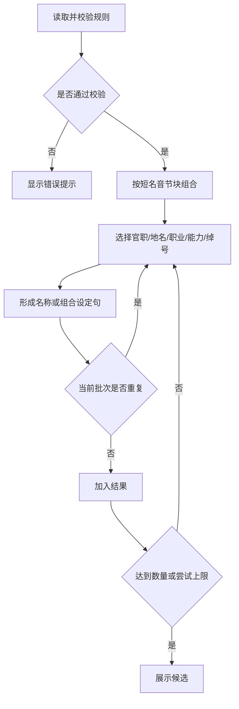

# 2. 命名生成

### 2.1 输入

生成页支持选择族群、名称类型、数量、短名长度、人名后缀、绰号与职业/能力偏好。生成过程完全在渲染进程本地完成。

| 参数     | 范围 / 默认值                    | 来源                           |
| -------- | -------------------------------- | ------------------------------ |
| 族群     | 人族、妖族；默认人族             | `RACE_KEYS`                    |
| 类型     | 人名、地名、官职、绰号；至少一项 | `TYPE_KEYS`                    |
| 数量     | 5–100；默认 10                   | `DEFAULT_GEN_PARAMS.count`     |
| 短名     | 2 字、3 字、2–3 字混合           | `DEFAULT_GEN_PARAMS.shortMode` |
| 人名全名 | 2–8 字                           | 生成页与 `validate`            |
| 绰号     | 2–8 字                           | 生成页与 `genNickname`         |

选择多个类型时生成组合设定句，形式为“人名，任官职，居地名，以职业为营生，擅能力，绰号……”。

### 2.2 词库规模

词库位于 `src/data/lexicon.ts`。所有数组在构建前检查不得包含重复项。

| 词根         | 人族 | 妖族 |
| ------------ | ---: | ---: |
| 音节块       |   40 |   40 |
| 职业         |  180 |  160 |
| 特殊能力     |  120 |  120 |
| 双字地名前缀 |  140 |  146 |
| 单字地名前缀 |   64 |   64 |
| 单字地名后缀 |   72 |   72 |
| 双字地名后缀 |   80 |   80 |
| 官职属地     |  140 |  140 |
| 官职职权     |   48 |   48 |
| 官职层级     |   32 |   32 |
| 每类绰号来源 |  104 |  104 |
| 绰号补字     |   40 |   40 |
| 契约称号     |  100 |  100 |
| 血统称号     |   48 |   48 |
| 封号尊称     |   48 |   48 |

理论组合量采用 `bigint` 精确计算，避免扩充后的总量超过 JavaScript 安全整数。界面使用兆、亿、万等单位展示。

### 2.3 生成流程

### 2.4 输出

- 单条候选包含名称、族群、类型、字符数、结构标签、来源与时间。
- 保存入谱前候选只存在于页面内存。
- 单条换稿保留当前筛选来源并排除同批已有名称。
- 执行过的生成或筛选偏好持久化到 JSON；未保存的生成结果刷新后丢失。
