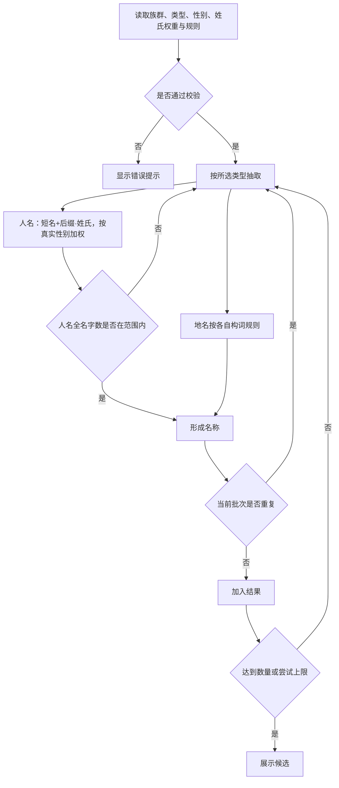

# 2. 命名生成

### 2.1 输入

生成页支持选择族群、名称类型、性别倾向与规则设置。族群、名称类型、性别倾向三者统一使用相同的 `Chip` 组件；数量、短名块数、姓氏人口权重、人名后缀与职业/能力偏好收进「规则设置」模态子窗口。生成过程完全在渲染进程本地完成。

| 参数         | 范围 / 默认值                      | 来源                                                      |
| ------------ | ---------------------------------- | --------------------------------------------------------- |
| 族群         | 人族、精灵族、妖鬼、混血；默认人族 | `RACE_KEYS`（偏好缺省 `human`）                           |
| 类型         | 人名、地名；单选                   | `TYPE_KEYS`                                               |
| 数量         | 5–100；默认 5                      | `DEFAULT_GEN_PARAMS.count`                                |
| 短名块数     | 2 字、3 字、2–3 字混合；默认混合   | `DEFAULT_GEN_PARAMS.shortMode`（`mix`）                   |
| 性别倾向     | 不限、男性、女性、中性；默认中性   | `GENDER_KEYS` / `DEFAULT_GEN_PARAMS.gender`（`neutral`）  |
| 姓氏人口权重 | 0–100；默认 50                     | `DEFAULT_GEN_PARAMS.surnameBias`、`SURNAME_BALANCED_BIAS` |
| 人名全名字数 | 2–8；默认 4–8                      | `DEFAULT_GEN_PARAMS.minChars/maxChars`                    |

行为约定：

- 名称类型为单选，点击另一类型会直接切换，不会叠加选择。
- 性别倾向位于生成页主界面、名称类型下方；**仅当选中「人名」时显示**（`GenerateTab.tsx` → `usesPerson`）。只生成地名时不显示性别行，地名候选也不带性别。
- 性别倾向标题与名称类型标题使用同一 `SectionTitle` 组件，选项与族群 / 类型使用同一 `Chip` 组件，并在标题下方左对齐排列。
  间距数值取自 CSS 变量：行内间距 `--app-choice-row-gap`（10px）、上下内边距 `--app-choice-row-padding-y`（10px）；名称类型 / 族群 Chip 行间距为 `--app-chip-row-gap`（8px）。三个变量均在 `src/App.css` 的 `:root` 中定义。
- 生成页不再提供多选类型与组合设定句；历史数据中的组合设定句候选仍可正常展示与编辑。
- 职业与特殊能力、数量、短名块数、姓氏权重、后缀等规则收进「规则设置」模态子窗口（原生 `BrowserWindow`，`modal: true`），不再向下展开；子窗口内「基础规则」在前、「职业与特殊能力」在后，且不显示顶部「当前：…」摘要行。子窗口写回 `preferences.md` 并通过 `workshop:rules:changed` 事件实时同步主窗口。
- 主界面「规则设置」按钮与「落笔生成」按钮在同一行，两者使用完全相同的宽高（156 × 44 px），不占满整行（`GenerateTab.tsx` → `.generate-action-row` / `src/App.css`）。
- 性别参数影响短名的音节加权倾向，不删除其他性别的音节。选择具体性别（男性/女性/中性）时，`SYLLABLE_GENDER_BIAS` 中对应音系池的音节获得 `GENDER_MATCH_WEIGHT = 7` 倍权重，其余音节保留 `GENDER_BASE_WEIGHT = 1`；选择「不限」时每条人名先随机解析为男性 / 女性 / 中性之一，再按该真实性别加权（`resolveActualGender`）。因此「不限」生成的候选 TAG 显示真实性别，而不是「不限」。
- 校验规则（`GenerateTab.tsx` → `validate`）：必须选中一种类型；数量 5–100；最少字数不得大于最多字数；姓氏权重 0–100。
- 命令行工具（§10）与生成页共用同一套引擎与词库：CLI 只暴露族群、类型、性别、权重、数量五个参数，其余规则固定为「2–3 字短名 + 父名 + 姓氏」，参数到内部规则的映射见 §10.4。

### 2.2 词库规模

词库索引与组合量计算位于 `src/data/lexicon.ts`，精灵族词条位于 `src/data/lexicon-elf.ts`，妖鬼族词条位于 `src/data/lexicon-yaogui.ts`。所有数组在构建前检查不得包含重复项。词库中的字符串数组统一按每行 20 个元素紧凑排列，并用 `// prettier-ignore` 固定，避免格式化器拆成一行一个。精灵族词库以自然、星辰、月光、森林、歌谣、符文与秘银等精灵意象为主，不包含妖魔、鬼怪、尸骨、血咒等词根。妖鬼族为独立词库，整体偏向幽冥、丧葬、骨血、诅咒、精怪与反派意象，含少量古体字 / 不常用字（如「魑魅魍魉」「酆都」「鬾鬽」），光明优雅词仅作极低概率点缀（约 0.3%）。人族与精灵族音节在原有各 160 个基础上扩充 50% 至 240 个，新增部分约 30% 为普通常用字（如「贝、莉、莎、特、斯、顿、勇、豪、威」），用于降低整体生成过度华丽的玛丽苏感；性别音系池同步扩充约 50%。混血的音节、性别音系与姓氏取人族 / 精灵族的并集（去重），不混入妖鬼；职业、地名、地名等通用词根复用人类词库。

| 词根         | 人族 | 精灵族 | 妖鬼 |
| ------------ | ---: | -----: | ---: |
| 音节块       |  240 |    240 |  160 |
| 职业         |  180 |    160 |  160 |
| 特殊能力     |  120 |    120 |  120 |
| 双字地名前缀 |  140 |    146 |  146 |
| 单字地名前缀 |   64 |     64 |   64 |
| 单字地名后缀 |   72 |     72 |   72 |
| 双字地名后缀 |   80 |     80 |   80 |
| 血统称号     |   48 |     48 |   48 |
| 封号尊称     |   48 |     48 |   48 |

理论组合量采用 `bigint` 精确计算，避免扩充后的总量超过 JavaScript 安全整数。界面使用兆、亿、万等单位展示。

每个种族包含 80 个姓氏；其中 8 个稀有姓氏占姓氏池的 10%，每个基准人口占比为 `0.01%`
（`SURNAME_RARE_POPULATION_SHARE = 0.0001`）。其余 72 个常见姓氏共享剩余人口占比。

姓氏进度条按以下规则改变采样权重（`src/data/lexicon.ts` → `surnameSelectionWeight`）：

| 滑块值 | 含义   | 权重规则                                                           |
| ------ | ------ | ------------------------------------------------------------------ |
| 0      | 按人口 | 使用姓氏人口占比，0.01% 姓氏很少出现                               |
| 50     | 均衡   | 所有姓氏等概率，稀有姓氏约占 10%                                   |
| 100    | 极稀有 | 对低人口姓氏施加反向权重，指数上限 `0.5`，低人口姓氏明显更易被抽到 |

滑块 `> 50` 时权重为 `pow(人口占比, -SURNAME_RARE_BIAS_MAX_EXPONENT × (bias - 50) / 50)`，指数从 `0` 线性增至 `SURNAME_RARE_BIAS_MAX_EXPONENT = 0.5`（`src/data/lexicon.ts` → `surnameSelectionWeight`）。以每族 80 个姓氏、8 个稀有姓氏估算，SSSR 抽样占比约为：50 → 10%、60 → 15%、70 → 23%、80 → 33%、90 → 44%、100 → 57%；即中等档位只是温和偏向稀有，不会在 70 就几乎必出 SSSR。

例如选择「人族、女性、贵族封号」，把姓氏权重调高，可生成带稀有姓氏、女性音系短名和贵族封号的姓名。

### 2.3 生成流程

批次尝试上限为 `params.count * 60 + 200`（`generateBatch`）。人名全名字数只约束单人名的全名，不约束地名。

### 2.4 人名组成与「·」分隔

人名**只保留一个「·」作为姓氏分隔符，且姓氏固定在后**：短名与父名/地名/职业等后缀直接相连，再接「·姓氏」。

| 后缀 / 开关  | 名称形式                      | 结构标签          |
| ------------ | ----------------------------- | ----------------- |
| 父名（默认） | `短名父名·姓氏`               | 仅稀有度 TAG      |
| 地名         | `短名地名·姓氏`               | 地形前缀/自然后缀 |
| 职业         | `短名职业·姓氏`               | 职业              |
| 血统         | `短名血统称号·姓氏`           | 血统称号          |
| 贵族封号     | `短名贵族封号·姓氏`           | 贵族封号          |

- 示例：姓氏「曜津」、短名「笛月」、父名「尔藤」→ `笛月尔藤·曜津`（旧形式 `曜津·笛月·尔藤` 已废弃）。
- 姓氏只保留在名称末尾，**不再渲染为结构 TAG**；人口占比也不再写入结构。稀有度改为独立 TAG（见下）。
- 稀有度按姓氏池人口占比升序排名分四档：最稀有 10% 为 `SSSR`，其后 10% 为 `SSS`，再后 20% 为 `SS`，其余为 `S`（`src/data/lexicon.ts` → `createSurnamePool`）。人口占比相同的姓氏按名称稳定排序，保证同一姓氏每次分级一致。`SSSR` 对应现有 8 个稀有姓氏。
- 稀有度作为候选独立字段 `rarity?: 'S' | 'SS' | 'SSS' | 'SSSR'`，由 `StructureTags` 渲染为独立 TAG，四种颜色分别为灰、松绿、金、朱红；地名等没有姓氏的类型不带稀有度。
- 父名后缀只把父名拼进名称，不新增结构标签；短名同样不再单独成标签。
- 历史组合设定句名称为 `短名·姓氏`，结构标签可包含人名、居地、营生、特殊能力；新生成不再产生组合设定句。
- 字数统计排除「·」：`nameCharCount(name)` 先删除所有「·」再按 Unicode 码点计数（`src/lib/generator.ts`；主进程 `workshop-markdown.cts` 同名函数规则一致）。例如「雷·恩医」计为 3 字。
- 性别不再作为结构标签拼进名称或结构；人名候选带独立 `gender` 字段，由界面渲染为性别 TAG（§2.5、§3.3）。

### 2.5 输出与结果表

- 单条候选包含名称、族群、类型、字符数、结构标签、稀有度（人名可选）、性别（人名可选）、来源与时间。
- 生成结果以表格展示，列为「名称、类型、字数、结构、操作」；操作列位于最右侧，宽度 `108px`
  （`App.css` / `.result-actions-head`），名称列最小宽度 `150px`（`App.css` / `.result-name-cell`）。
- 结构列由 `StructureTags` 渲染：每个结构块显示为 `标签·词`；人名额外追加稀有度 TAG（`tag-rarity` + `tag-rarity-s` / `tag-rarity-ss` / `tag-rarity-sss` / `tag-rarity-sssr`）与性别 TAG（`tag-gender`，样式来源 `src/App.css`；男性靛蓝、女性朱红、中性松绿；历史 `any` 仍为金色兜底）。生成偏好为「不限」时，TAG 显示该条候选实际解析出的男性 / 女性 / 中性，而不是「不限」；只有历史数据中缺失 `gender` 的候选才不显示 TAG。
- 操作列提供「保存入谱、复制、加入设定」图标；点击「保存入谱」后立即写入当前项目的 `.workshop/candidates.md` 并就地变为已完成状态，不弹出备注输入框；不提供整批入谱入口，只能逐条保存。
- 人名结构不展示姓氏 TAG；姓氏保留在名称末尾，其稀有度由独立 TAG 展示（§2.4）。
- 保存入谱前候选只存在于页面内存；性别随候选一起提交并落入 `candidates.md` 的 `- 性别:` 字段。
- 单条换稿保留当前筛选来源并排除同批已有名称；换稿后性别按新名称解析出的真实性别更新（仅人名），其它类型不变。
- 执行过的生成偏好持久化到当前项目 `.workshop/preferences.md` 的 `generator` 节；规则设置子窗口的修改会立即持久化并同步主窗口。未保存的生成结果刷新或重启后丢失。
- 切换底部页签或打开设定编辑器不会清空当前批次生成结果（生成页常驻挂载、只隐藏不卸载）。

### 2.6 生成偏好的版本迁移

生成偏好写入 `preferences.md` 的 `generator` 节，结构为 `GenPrefs`：`{ schemaVersion, race, types, params }`（`src/lib/generator.ts`）。

- 当前 `GEN_PREFS_SCHEMA_VERSION = 2`。
- 读取时 `normalizeGenPrefs` 会补齐非法/缺失字段；`gender` 不在 `GENDER_KEYS` 内时回退默认值。
- **一次性迁移**：旧偏好没有 `schemaVersion` 或版本小于 2 时，若 `params.gender === 'any'`，迁移为默认的 `neutral`；写入新版本偏好后（`schemaVersion: 2`），用户手动选回的「不限」可正常持久化，并在生成时解析为每条候选的真实性别。
- 更早版本没有 `gender`/`surnameBias` 字段时，历史默认全名字数 `4–6` 会放宽为 `4–8`（`isBeforeGenderPrefs` 分支）；`minChars`/`maxChars` 均被限制在 2–8；历史 `personSuffix: contract` 回退为 `father`。
- 迁移在渲染层读取偏好时完成；`preferences.get('generator')` 本身返回文件中的原始对象。
