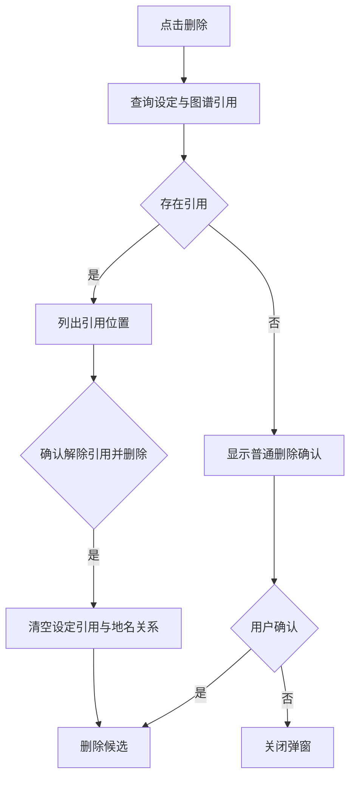

# 3. 候选库

### 3.1 列表与筛选

候选库支持族群、类型、字符数、收藏状态、关联状态、关键词和排序筛选。关键词比较不区分大小写，使用当前中文区域规则。

| 筛选   | 默认值   |
| ------ | -------- |
| 族群   | 全部     |
| 类型   | 全部     |
| 字符数 | 1–99     |
| 状态   | 全部     |
| 排序   | 最新保存 |

筛选条件保存在 `workshop.json` 的 `preferences.libraryFilters` 中，应用重启后恢复。

### 3.2 保存规则

- 同一族群、类型与名称完全相同时视为重复，不再次保存。
- 收藏与普通保存都会进入候选库；收藏状态可单独切换。
- 候选备注可手动编辑并保存。
- 保存操作写入 JSON 后再返回成功，失败时保留当前页面内容并显示错误。

### 3.3 详情与加入设定

详情面板展示名称结构、备注与操作。点击“加入设定”会打开设定编辑器并带入职业、官职、居地、绰号、契约和能力备注。

### 3.4 删除流程

查询引用不会修改数据；只有用户在确认弹窗中再次确认后才执行删除。

### 3.5 AI 入口

“AI 详细设定”按钮保留，但当前版本不包含 AI 实现或网络调用。点击按钮只显示不可用说明弹窗。
