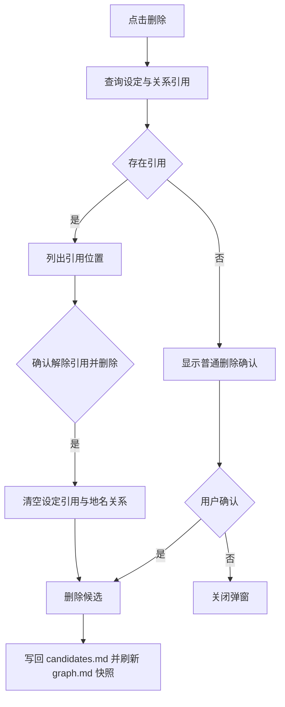

# 3. 候选库

### 3.1 列表与筛选

候选库支持族群、类型、字符数、收藏状态、关联状态、关键词和排序筛选。关键词比较不区分大小写，使用当前中文区域规则（`toLocaleLowerCase('zh-CN')`）。

| 筛选   | 默认值   |
| ------ | -------- |
| 族群   | 全部     |
| 类型   | 全部     |
| 字符数 | 1–99     |
| 状态   | 全部     |
| 排序   | 最新保存 |

- 字段默认值来自 `src/lib/types.ts` → `DEFAULT_FILTERS`；字数筛选上限为 `FILTER_MAX_CHARS = 99`。
- 筛选条件保存在**当前项目** `.workshop/preferences.md` 的 `libraryFilters` 节中（`preferences` 键 `libraryFilters`），应用重启并重新打开同一项目后恢复。
- 字符数筛选基于读取 Markdown 时按名称重算的 `charCount`；该值计算时排除「·」分隔符（§2.4）。
- 列表返回的每条候选额外带 `referenced`（是否被设定卡或地名关系引用）。

### 3.2 保存规则

- 同一族群、类型与名称完全相同时视为重复，不再次保存；主进程返回 `duplicate: true` 与提示「该名称已在库中」。
- 收藏与普通保存都会进入候选库；收藏状态可单独切换。
- 候选备注可手动编辑并保存；更新备注/收藏会刷新 `updatedAt`。
- 保存操作写入当前项目 `.workshop/candidates.md` 后再返回成功，失败时保留当前页面内容并显示错误。
- 保存时同时支持可选的 `gender` 字段（`NameGender`：`any` / `male` / `female` / `neutral`）；仅人名与组合设定句会带性别，地名/官职/绰号不带。写入时为空则省略该字段。

### 3.3 详情与加入设定

详情面板展示名称结构、稀有度 TAG、性别 TAG、备注与操作。稀有度 TAG 显示 `S` / `SS` / `SSS` / `SSSR`，分别使用灰、松绿、金、朱红四种颜色。性别 TAG 由 `StructureTags` 在结构标签末尾追加（`tag-gender` + `tag-gender-male` / `tag-gender-female` / `tag-gender-neutral`，样式见 `src/App.css`），文本为「男性 / 女性 / 中性」，并用三种不同颜色区分（男性靛蓝、女性朱红、中性松绿）；生成偏好为「不限」时保存的是每条候选实际解析出的真实性别，不会显示「不限」。无 `gender` 字段的候选不显示该 TAG。

点击“加入设定”会打开设定编辑器并带入职业、官职、居地、绰号、契约和能力备注（`candidateToSheetFields`）。性别不参与设定卡字段映射。

### 3.4 删除流程

查询引用不会修改数据；只有用户在确认弹窗中再次确认后才执行删除。`force=false` 且存在引用时主进程拒绝删除并返回引用情况。删除成功后级联清空 `sheets.md` 中对应 `候选关联` / `籍贯候选`，移除以该候选为端点（`place`）的 `relations.md` 记录，并刷新 `graph.md` 快照。

### 3.5 AI 入口

“AI 详细设定”按钮保留，但当前版本不包含 AI 实现或网络调用。点击按钮只显示不可用说明弹窗（§6.1）。
