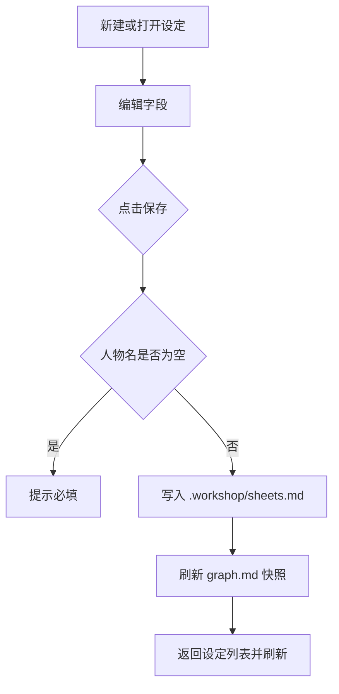

# 4. 设定卡与关系

### 4.1 设定卡字段

| 字段     | 是否必填 | 说明                            |
| -------- | -------- | ------------------------------- |
| 人物名   | 是       | 首尾空白会移除；空值拒绝保存    |
| 族群     | 是       | 人族或精灵族                    |
| 候选关联 | 否       | 保存对应候选 ID                 |
| 职业     | 否       | 可从种族词库补全                |
| 官职     | 否       | 可从实时生成建议补全            |
| 籍贯     | 否       | 可关联地名候选（`籍贯候选` ID） |
| 绰号     | 否       | 可从词库补全                    |
| 契约称号 | 否       | 可从词库补全                    |
| 备注     | 否       | 自由文本                        |

新建或编辑保存后立即写入当前项目 `.workshop/sheets.md`；职业、官职、籍贯、绰号、契约称号与备注在保存时去除首尾空白。编辑器发现未保存修改时，离开前显示确认弹窗。

设定卡的 `候选关联` 与 `籍贯候选` 只保存候选 ID；性别字段仅存在于候选（`candidates.md`），设定卡不记录性别，也不因候选性别改变关系或图谱规则。

### 4.2 人物来源

- 手动填写：直接输入名称。
- 候选库选择：带出候选名称及可映射字段（职业、官职、居地、绰号、契约；特殊能力/血统/封号等并入备注）。
- 现场生成：按默认生成规则给出三组名称，可换一批。

### 4.3 关系规则

关系类型为师徒、父子、同僚、敌对、隶属、契约、其他（`RELATION_TYPES`）。关系目标可以是另一张设定卡或一个地名候选。

- 来源与目标 ID 不得相同；空来源/空目标拒绝添加。
- 同一来源、目标与关系类型不能重复添加。
- 删除设定卡会同步删除与其相关的人物关系和地名关系（`sheetDelete`）。
- 删除候选时，如用户确认强制删除，会清空设定卡中的角色/籍贯引用并移除地名关系（§3.4）。
- 关系写入当前项目 `.workshop/relations.md`；每次增删关系后刷新 `.workshop/graph.md` 快照。

### 4.4 编辑流程

