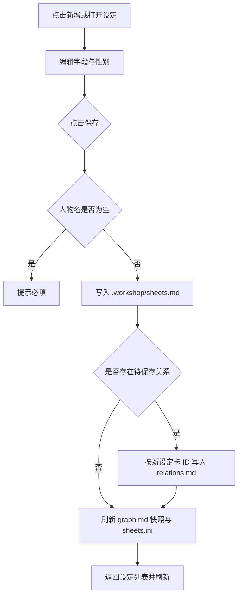

# 4. 设定卡与关系

### 4.1 设定卡字段

| 字段     | 是否必填 | 说明                            |
| -------- | -------- | ------------------------------- |
| 人物名   | 是       | 首尾空白会移除；空值拒绝保存    |
| 族群     | 是       | 人族或精灵族                    |
| 性别     | 否       | 男性 / 女性 / 中性；未选可不填  |
| 候选关联 | 否       | 保存对应候选 ID                 |
| 职业     | 否       | 可从种族词库补全                |
| 官职     | 否       | 可从实时生成建议补全            |
| 籍贯     | 否       | 可关联地名候选（`籍贯候选` ID） |
| 绰号     | 否       | 可从词库补全                    |
| 契约称号 | 否       | 可从词库补全                    |
| 备注     | 否       | 自由文本                        |

新建或编辑保存后立即写入当前项目 `.workshop/sheets.md` 并重建 `sheets.ini`；职业、官职、籍贯、绰号、契约称号与备注在保存时去除首尾空白。编辑器发现未保存修改时，离开前显示确认弹窗。

设定卡的 `候选关联` 与 `籍贯候选` 只保存候选 ID。性别为设定卡自身字段（`gender`，取值 `male` / `female` / `neutral`），可从候选带入、手动选择，也可留空；设定列表在族群后显示性别。性别仅用于展示，不改变关系或图谱规则。

设定页标题栏在「刷新」按钮左侧提供「新增」按钮（`data-testid="sheets-new"`），点击进入新建设定卡编辑器；空列表状态下的「新建设定」入口行为相同。

### 4.2 人物来源

- 手动填写：直接输入名称，并可选择性别。
- 候选库选择：带出候选名称、性别及可映射字段（职业、官职、居地、绰号、契约；特殊能力/血统/封号等并入备注）。
- 现场生成：按默认生成规则给出三组名称，可换一批。

### 4.3 关系规则

关系类型为师徒、父子、同僚、敌对、隶属、契约、男主、女主、女配、男配、其他（`RELATION_TYPES`）。关系目标可以是另一张设定卡、当前设定卡自身（「关联自己」）或一个地名候选。人物目标列表首位固定提供「自己」选项，新建尚未保存的设定卡也可先关联自己，保存后目标自动指向新设定卡 ID。

新建尚未保存的设定卡时也可以先选目标、关系类型与备注添加关系；这些关系显示为「待保存」，在保存设定卡成功后自动写入，取消离开或未保存时不会写入。编辑已有设定卡时关系即时增删。关联自身的关系在设定卡关系中显示为「自己」，仅用于记录男主 / 女主等标记，不进入图谱。

- 来源与目标不能为空；允许来源与目标 ID 相同（关联自己）。
- 同一来源、目标与关系类型不能重复添加。
- 删除设定卡会同步删除与其相关的人物关系和地名关系（`sheetDelete`）。
- 删除候选时，如用户确认强制删除，会清空设定卡中的角色/籍贯引用并移除地名关系（§3.4）。
- 关系写入当前项目 `.workshop/relations.md`；每次增删关系后刷新 `.workshop/graph.md` 快照。

### 4.4 编辑流程

