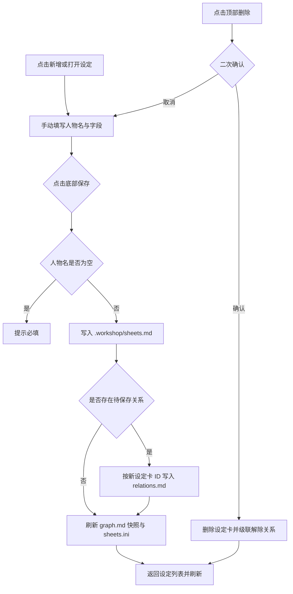

# 4. 设定卡、地名与关系

### 4.1 设定卡字段

| 字段     | 是否必填 | 说明                                      |
| -------- | -------- | ----------------------------------------- |
| 人物名   | 是       | 只能手动输入；首尾空白会移除；空值拒绝保存 |
| 族群     | 是       | 人族 / 精灵族 / 妖鬼 / 混血                |
| 性别     | 否       | 男性 / 女性 / 中性；新建默认「男性」      |
| 候选关联 | 否       | 从候选库加入时保存对应候选 ID             |
| 职业     | 否       | 可从种族词库补全                          |
| 籍贯     | 否       | 使用独立地名库，可多选（保存地名 ID 列表） |
| 备注     | 否       | 自由文本                                  |

新建或编辑保存后立即写入当前项目 `.workshop/sheets.md` 并重建 `sheets.ini`；职业、籍贯与备注在保存时去除首尾空白。编辑器发现未保存修改时，离开前显示确认弹窗。

- 名称不再提供「候选库选择」「现场生成」入口，只能手动输入；从候选库「加入设定」或生成页「加入设定」时仍会自动预填名称、族群、性别、职业与备注。
- 新建设定卡默认选中「人族 + 男性」。
- 设定卡的 `候选关联` 只保存候选 ID。性别为设定卡自身字段（`gender`，取值 `male` / `female` / `neutral`），也可留空；设定列表在族群后显示性别。
- `hometownIds: string[]` 保存所选地名 ID，`hometown` 保存以「、」连接的展示文本；地名删除时自动从引用中移除（§4.5）。

设定页（`SheetsTab.tsx`）为**紧凑表格**，顶部筛选直接平铺，只保留「族群」与「搜索」两项：

| 列     | 内容                                         |
| ------ | -------------------------------------------- |
| 人物名 | 印章 + 名称                                  |
| 族群   | 中文族群名                                   |
| 性别   | 男性 / 女性 / 中性；未填显示「—」            |
| 职业   | 超长省略（悬停显示完整）                     |
| 籍贯   | 多个地名以「、」连接，超长省略               |
| 关系   | 关系数量                                     |
| 备注   | 单行截断显示（悬停显示完整），不展示全文     |
| 操作   | 编辑按钮                                     |

页头「新增」按钮（`data-testid="sheets-new"`）进入新建设定卡编辑器。

### 4.2 关系规则

关系类型为师徒、父子、同僚、敌对、隶属、契约、配偶、仰慕者、暗恋、男主、女主、女配、男配、其他（`RELATION_TYPES`）。**关系只能关联人物**（设定卡或当前设定卡自身），不再提供「关联地名」。

人物目标列表首位固定提供「自己」选项，新建尚未保存的设定卡也可先关联自己，保存后目标自动指向新设定卡 ID。

选中「其他」关系类型时显示「自定义关系」输入框：有输入时以输入内容作为实际关系类型写入（`relations.md` 的 `关系类型` 与 `sheets.md` 的 `关系` 摘要），留空仍记为「其他」。

新建尚未保存的设定卡时也可以先选目标、关系类型与自定义关系添加关系；这些关系显示为「待保存」，在保存设定卡成功后自动写入，取消离开或未保存时不会写入。编辑已有设定卡时关系即时增删。若已选好目标与关系类型但未点「添加关系」就直接保存，保存时会按当前选择自动补加一条关系（与已有关系或待保存列表重复时跳过）。关联自身的关系在设定卡关系中显示为「自己」，用于记录男主 / 女主等标记；图谱中同样保留该关系，以人物节点上的自环呈现。

- 来源与目标不能为空；允许来源与目标 ID 相同（关联自己）。
- 同一来源、目标与关系类型不能重复添加。
- 删除入口位于设定卡编辑界面顶部；点击后弹出二次确认，确认后调用 `sheetDelete` 删除设定卡并同步删除与其相关的人物关系，随后返回列表。
- 关系写入当前项目 `.workshop/relations.md`；每次增删关系后刷新 `.workshop/graph.md` 快照，并重写 `.workshop/sheets.md` 中每张设定卡的派生字段 `关系`，格式为 `自己（男主）、兰诺（同僚）`（关联自身在前，无关系时不写该行）。

### 4.3 编辑流程

### 4.4 地名库

地名系统独立于候选库与设定卡，数据保存在 `.workshop/places.md`。

- 生成页名称类型选择「地名」时，结果操作按钮为「加入地名」（不再显示「加入设定」），点击写入地名库。
- 地名页（`PlacesTab.tsx`）为**紧凑表格**，顶部平铺筛选只保留「族群」与「搜索」；列包含地名、族群、字数、备注（单行截断）与操作。
- 页头「新增」按钮打开地名编辑弹窗，可手动填写地名、族群与备注；每行提供编辑与删除。
- 地名删除时，引用该地名的设定卡会自动移除对应 `hometownIds` 与展示文本。
- 旧版混在候选库中的地名会在打开项目时自动迁移到 `places.md`，并从候选库移除（§7.3）。

### 4.5 设定页与地名页筛选

两页均使用平铺筛选（不折叠面板），只保留：

| 筛选 | 说明                       |
| ---- | -------------------------- |
| 族群 | 全部 / 人族 / 精灵族 / 妖鬼 / 混血 |
| 搜索 | 按名称、职业、籍贯、备注模糊匹配 |

数据变更后点击页头刷新按钮重新读取当前项目文件。
