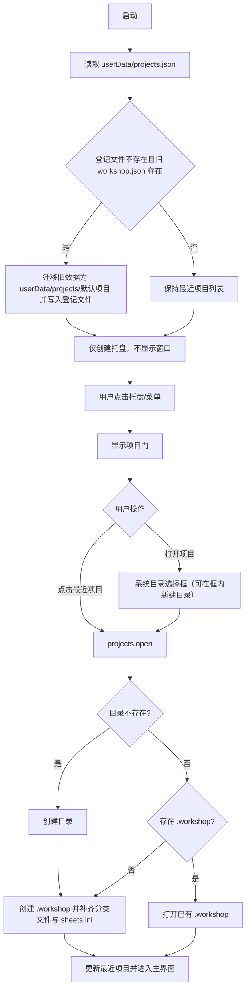
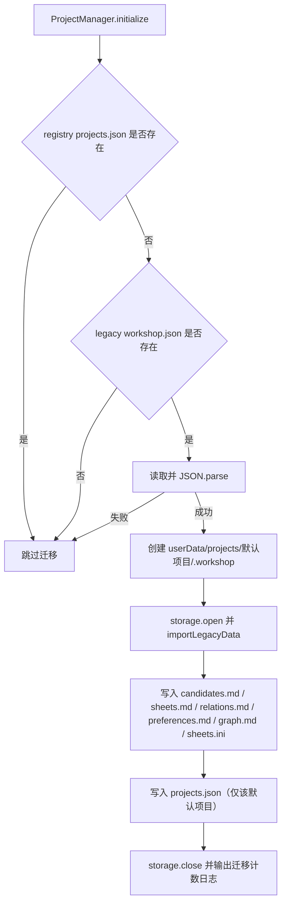

# 7. 持久化与 IPC

### 7.1 启动、项目选择与打开

应用启动时只驻留托盘，不打开主窗口；用户点击托盘或菜单后才显示项目门。`projects.current()` 在启动时为 `null`（主进程不在启动时恢复上次项目）。



- 「打开项目」与最近项目点击都走 `projects.open(path)`：目录不存在时自动 `mkdir`；目录存在但缺少 `.workshop` 时自动初始化；已有 `.workshop` 时直接打开。因此项目门不再区分「新建项目」与「打开已有项目」，也不再提供刷新按钮。
- **协议打开**：外部程序可通过 `workshop://project/open?name=<项目名称>` 打开项目。主进程在最近项目中按展示名或目录名匹配（忽略大小写），命中后调用 `ProjectManager.openByName(name)`，等价于 `projects.open(path)`；未命中时显示主窗口与错误对话框。详见 §1.9。
- **空目录初始化**：目录原本为空（或不存在、刚被创建）时，额外创建 `README.md`（首行 `# <目录名>`）与 `第一卷/第一章.md`；已有内容或已有 `.workshop` 的目录不会补写。
- 项目展示名优先取 `README.md` 第一行（去掉 `#` 前缀），无 README / 首行为空时回退登记名称；`listRecent()` 与 `open()` 都会读取。
- 项目门最近项目按 `lastOpenedAt` 倒序，第一条显示「上次」TAG（`ProjectGate.tsx`）。
- `projects.create({ parentDir, name })` IPC 与 `ProjectManager.create` 仍保留以兼容旧调用；项目名称校验与非空目录限制仍在该路径生效，但当前 UI 不再调用。日常新建项目使用「打开项目」选择一个新目录。
- 打开项目成功后主进程输出日志（`console.info`）：
  - `[Creation Workshop] 项目登记文件：<userData>/projects.json`（启动时）
  - `[Creation Workshop] 项目：<项目目录绝对路径>`
  - `[Creation Workshop] 项目数据目录：<项目目录>/.workshop`
- 设置页「切换项目」只把渲染层项目置空并回到项目门；没有关闭项目的 IPC，主进程内当前项目在下次 `open`/`create` 时被替换。
- **从最近列表移除**：项目门每条最近项目右侧有删除图标按钮（`data-testid="project-delete-<项目名>"`），二次确认（`project-remove-confirm`）后调用 `projects.removeRecent(path)`。该操作只从 `projects.json` 的 `recentProjects` 删除对应条目，**不删除项目目录或 `.workshop` 文件**；若移除的是当前项目，主进程同时关闭数据服务并清空当前项目。
- 设置页「总览」为只读 Markdown 视图：调用 `projects.overview()` 直接读取当前项目 `.workshop/overview.md` 全文并渲染，可点击刷新（`settings-overview-refresh`）；文件不存在或正文为空时**整块「总览」区域（标题、刷新按钮与提示）都不渲染**，不写盘。

### 7.2 项目登记文件 `userData/projects.json`

- 路径：`<userData>/<creationWorkshop.project.registryFileName>`，默认 `projects.json`。
- 结构：

```json
{
  "schemaVersion": 1,
  "recentProjects": [
    {
      "path": "/Users/alex/Documents/我的小说",
      "name": "我的小说",
      "lastOpenedAt": 1770000000000
    }
  ]
}
```

| 字段                            | 说明                                                                 |
| ------------------------------- | -------------------------------------------------------------------- |
| `schemaVersion`                 | 固定为 `1`                                                           |
| `recentProjects[].path`         | 项目目录绝对路径                                                     |
| `recentProjects[].name`         | 项目展示名（优先来自 `README.md` 第一行，缺失时用登记名称 / 目录名） |
| `recentProjects[].lastOpenedAt` | 最近打开时间戳（毫秒）                                               |

行为：

- 最近项目按 `lastOpenedAt` 倒序；同一路径只保留一条（重新打开时提到最前）。
- `listRecent()` 返回前会逐个读取项目的 `README.md` 第一行作为展示名，因此外部修改 README 后重新启动即可看到新名称。
- 最多保留 `creationWorkshop.project.maxRecentProjects` 条（默认 `10`）。
- 查询最近项目时过滤掉目录已不存在的条目；目录存在但缺少 `.workshop` 时仍保留，点击后会重新初始化。登记文件本身不立即重写。
- 写入采用「`.tmp` + rename」原子替换；`userData` 目录不存在时先创建。
- 登记文件不存在或 JSON 损坏时从空列表开始（不抛错）。
- `removeRecent(path)` 只删除 `recentProjects` 中路径完全匹配（`resolve` 后比较）的条目并重写登记文件；不触碰项目目录与 `.workshop`；路径不在列表中时返回 `{ ok: false, message }`。
- 该文件是全局的（不属于某个项目）；项目数据本身不存放在这里。

### 7.3 项目目录结构

```text
<项目目录>/
├── README.md                  # 空目录初始化时创建；首行作为项目展示名
├── 第一卷/
│   └── 第一章.md              # 空目录初始化时创建
└── .workshop/                 # 目录名来自 creationWorkshop.project.dataDirName，默认 .workshop
    ├── project.md             # 项目名称、格式版本、创建时间
    ├── overview.md            # 项目总览（可选，应用不自动创建；设置页只读展示）
    ├── candidates.md          # 人物名称候选
    ├── places.md              # 独立地名库
    ├── sheets.md              # 设定卡
    ├── relations.md           # 人物关系
    ├── graph.md               # 图谱布局坐标 + 节点/连线快照
    ├── preferences.md         # 生成规则与候选库筛选（JSON 片段）
    └── sheets.ini             # 由设定卡派生的 [人物] 清单，候选仅以注释列在 [候选]
```

首次升级时另见迁移目录：

```text
<userData>/
├── projects.json              # 迁移后写入
├── workshop.json              # 旧版单 JSON（迁移源，读取后保留）
└── projects/
    └── 默认项目/               # 重名时依次使用 默认项目-2、默认项目-3…
        └── .workshop/…
```

`WorkshopStorage.open(projectPath)` 会创建缺失的 `.workshop` 目录与七个 Markdown 文件（空数据骨架）；已存在的文件不会被覆盖；`overview.md` 不在此列，永远不会被自动创建。缺失文件在读取时按空数据处理。`sheets.ini` 不读取、每次打开时按当前数据重新生成并覆盖。打开项目时会把旧版 `candidates.md` 中类型为「地名」的条目迁移到 `places.md` 并从候选库移除（幂等）。

### 7.4 `.workshop` Markdown 格式

所有文件是「`#` 总标题 + `##` 分节 + `- 字段: 值` 字段行」的可读 Markdown（`overview.md` 除外，为自由格式）。解析器按行工作，**容错读取**：跳过不完整或无法识别的条目，不因单个坏条目导致整份文件读取失败。

通用规则（`src/electron/services/workshop-markdown.cts`）：

- 分节以 `## ` 开头；每条候选/设定/关系是一个 `##` 分节。
- 字段行格式 `- 字段: 值`；分隔优先匹配 `": "`，否则按第一个 `:` 拆分。
- 结构子项使用缩进两格以上的 `  - 标签: 词`，归属上一条字段行（`结构`）。
- 以反引号包裹的值读取时去掉反引号，用于 ID 与关联 ID（写出时 ID 一律加反引号）。
- 值包含换行、制表符、首尾空白或以 `"` 开头时，写出为 JSON 字符串（如 `"第一行\n第二行"`）；读取时若以 `"` 开头则按 JSON 字符串解析，失败保留原文。
- 备注、名称等普通文本原样保存；空字段行写为空值（如 `- 备注: `）。
- 时间：写出为 ISO 8601（`toISOString()`）；读取无法解析时回退为当前时间。
- 字数不信任文件：读取时按名称重新计算并忽略 `·` 分隔符，写出的 `- 字数` 仅供人阅读。
- 枚举接受中文标签或英文 key：族群「人族/human」「精灵族/elf」「妖鬼/yaogui」「混血/mixed」，旧值 `demon`、`妖族` 归一为 `elf`；类型「人名/person」「地名/place」，旧「官职/office」「绰号/nickname」统一按人名读取；性别「不限/any」「男性/male」「女性/female」「中性/neutral」；`来源` 只有「手动」视为 `manual`，其余为 `generated`；`收藏` 为「是/true/1」时视为真；`来源类型`/`目标类型` 统一视为设定卡（关系只允许人物）。
- 未知字段、未知分节、无法解析的字段行会被忽略；缺少必需字段的条目被跳过。

#### 7.4.1 `project.md`

```markdown
# 项目：我的小说

> 本文件由「Creation Workshop」维护；项目数据保存在同目录的 `.workshop` 中。

- 格式版本: 1
- 创建时间: 2026-10-26T05:57:48.000Z
```

| 字段     | 说明                                                  |
| -------- | ----------------------------------------------------- |
| 一级标题 | `# 项目：<名称>`；名称缺失时回退为项目目录名          |
| 格式版本 | 固定 `SCHEMA_VERSION = 1`；读取仅供记录，不做版本升级 |
| 创建时间 | 首次创建时写入；已有文件在打开时保持原值              |

`open()` 仅在 `project.md` 不存在或内容为空时写入；因此重命名标题可手动修改项目名，重新打开后登记列表名称随之更新。新建项目的模板到字段行为止；已有文件不会被自动补写内容。

项目总览保存在独立文件 `overview.md`（可选、自由格式 Markdown，不使用 `project.md` 小节）：整个文件内容去除首尾空白后即总览正文，由设置页通过 `projects.overview()` 读取并只读渲染。应用不创建、不修改该文件（手动用编辑器维护即可）；文件不存在或正文为空时设置页**整块隐藏「总览」区域**（标题、刷新按钮与提示都不渲染），不写盘。

#### 7.4.2 `candidates.md`

```markdown
# 名称候选

> 由「Creation Workshop」自动维护。每条候选以 `##` 分隔，字段行请保持 `- 字段: 值` 格式。

## 雷·恩医·珂希

- ID: `1f0f2f5e-…`
- 名称: 雷·恩医·珂希
- 族群: 人族
- 类型: 人名
- 性别: 中性
- 稀有度: SSSR
- 字数: 5
- 来源: 生成
- 收藏: 是
- 备注:
- 创建时间: 2026-10-26T05:57:48.000Z
- 更新时间: 2026-10-26T05:57:48.000Z
```

| 字段                    | 是否必读 | 说明                                                                                        |
| ----------------------- | -------- | ------------------------------------------------------------------------------------------- |
| `ID`                    | 是       | 候选唯一 ID；缺失则跳过该条目                                                               |
| `名称`                  | 是       | 缺失时回退使用 `##` 标题；两者均空则跳过                                                    |
| `族群`                  | 否       | 缺省 `human`                                                                                |
| `类型`                  | 否       | 缺省 `person`                                                                               |
| `性别`                  | 否       | 仅人名（含历史组合设定句）写出；缺失则不显示性别 TAG                                        |
| `稀有度`                | 否       | `S` / `SS` / `SSS` / `SSSR`；仅带姓氏的人名（含历史组合设定句）写出，缺失则不显示稀有度 TAG |
| `字数`                  | 否       | 仅供阅读，读取时按名称重算                                                                  |
| `来源`                  | 否       | 生成 / 手动                                                                                 |
| `收藏`                  | 否       | 是 / 否                                                                                     |
| `备注`                  | 否       | 自由文本                                                                                    |
| `创建时间` / `更新时间` | 否       | 缺失时回退当前时间                                                                          |
| `结构`                  | 否       | 子项 `标签: 词`；结构项为空时不写该字段行                                                   |

#### 7.4.3 `sheets.md`

```markdown
# 设定卡

> 由「Creation Workshop」自动维护。每张设定卡以 `##` 分隔，字段行请保持 `- 字段: 值` 格式。

## 雷恩

- ID: `b2a1…`
- 人物名: 雷恩
- 族群: 人族
- 性别: 男性
- 候选关联: `1f0f2f5e-…`
- 职业: 剑修
- 籍贯: 青云城、落霞谷
- 籍贯 ID: `0c9a…`, `7b21…`
- 备注:
- 关系: 自己（男主）、兰诺（同僚）
- 创建时间: 2026-10-26T05:57:48.000Z
- 更新时间: 2026-10-26T05:57:48.000Z
```

| 字段                                                    | 是否必读 | 说明                                                                                              |
| ------------------------------------------------------- | -------- | ------------------------------------------------------------------------------------------------- |
| `ID`                                                    | 是       | 缺失则跳过                                                                                        |
| `人物名`                                                | 是       | 缺失时回退 `##` 标题；两者均空则跳过                                                              |
| `族群`                                                  | 否       | 缺省 `human`                                                                                      |
| `性别`                                                  | 否       | 男性 / 女性 / 中性；缺失表示未设定                                                                |
| `候选关联`                                              | 否       | 为空时不写该行；读取为空字符串                                                                    |
| `职业` / `籍贯` / `备注`                                | 否       | 保存时去首尾空白；`籍贯` 为多个地名以「、」连接的展示文本                                         |
| `籍贯 ID`                                               | 否       | 可多个，逗号分隔并加反引号；为空时不写该行                                                        |
| `关系`                                                  | 否       | 派生字段：由 `relations.md` 汇总，格式 `自己（男主）、兰诺（同僚）`；无关系时不写该行，读取时忽略 |
| `创建时间` / `更新时间`                                 | 否       | 缺失时回退当前时间                                                                                |

#### 7.4.4 `relations.md`

```markdown
# 人物与地名关系

> 由「Creation Workshop」自动维护。每条关系以 `##` 分隔，字段行请保持 `- 字段: 值` 格式。

## 雷恩 — 同僚 → 兰诺

- ID: `c3d4…`
- 来源类型: 设定卡
- 来源 ID: `b2a1…`
- 来源名称: 雷恩
- 目标类型: 设定卡
- 目标 ID: `e5f6…`
- 目标名称: 兰诺
- 关系类型: 同僚
- 备注:
- 创建时间: 2026-10-26T05:57:48.000Z
```

| 字段                    | 是否必读 | 说明                                                         |
| ----------------------- | -------- | ------------------------------------------------------------ |
| `ID`                    | 是       | 缺失则跳过                                                   |
| `来源 ID` / `目标 ID`   | 是       | 缺失或两者相同则跳过该条目                                   |
| `来源类型` / `目标类型` | 否       | 缺省设定卡；「地名」视为地名                                 |
| `来源名称` / `目标名称` | 否       | 缺省「未命名」                                               |
| `关系类型`              | 否       | 缺省「其他」；选择「其他」并填写自定义关系时写入该自定义文本 |
| `备注`                  | 否       | 自由文本                                                     |
| `创建时间`              | 否       | 缺失时回退当前时间                                           |

#### 7.4.5 `graph.md`

```markdown
# 图谱

> 节点与连线由设定卡和关系实时派生；本文件保存节点布局坐标与最近一次快照。

- 更新时间: 2026-10-26T05:57:48.000Z
- 节点数: 2
- 连线数: 1

## 节点布局

| 节点 ID   | X      | Y     |
| --------- | ------ | ----- |
| `s:b2a1…` | 120.00 | 88.50 |

## 节点快照

- 人物：雷恩（人族）
- 地名：青云城（人族）

## 连线快照

- 雷恩 — 同僚 → 兰诺
```

| 部分          | 说明                                                                                                              |
| ------------- | ----------------------------------------------------------------------------------------------------------------- |
| 顶部字段      | `更新时间`、`节点数`、`连线数`；读取只使用 `更新时间`                                                             |
| `## 节点布局` | Markdown 表格，列为「节点 ID / X / Y」；ID 用反引号包裹；坐标保留两位小数。读取时跳过表头与分隔行，非有限数值忽略 |
| `## 节点快照` | 由设定卡与独立地名库派生的人物/地名清单；**只供阅读，不参与恢复**                                                 |
| `## 连线快照` | 由关系派生的连线清单（含关联自身，写作 `甲 — 男主 → 甲`）；同上                                                   |

节点 ID 规则：设定卡 `s:<sheetId>`，地名 `p:<placeId>`。快照节点来源：全部设定卡 + 被设定 `hometownIds` 引用的地名；边只在两端节点都存在时写入。

#### 7.4.6 `preferences.md`

````markdown
# 偏好设置

> 生成规则与候选库筛选条件，内容为 JSON，便于无损读写。

## 生成规则

```json
{
  "schemaVersion": 2,
  "race": "human",
  "types": ["person"],
  "params": { "gender": "neutral", "count": 10 }
}
```

## 候选库筛选

```json
{
  "race": "all",
  "nameType": "all",
  "minChars": 1,
  "maxChars": 99,
  "status": "all",
  "keyword": "",
  "sort": "latest"
}
```
````

- 只识别「生成规则」与「候选库筛选」两节（对应偏好键 `generator`、`libraryFilters`）；其它节忽略。
- 每节内容是 JSON 围栏中的 JSON 对象；解析失败或不是对象时忽略该节，界面回退默认偏好。
- 偏好值按原样保存（不做字段裁剪），由渲染层读取后做规范化；例如生成偏好由 `normalizeGenPrefs` 迁移（§2.6）。

#### 7.4.7 `sheets.ini`

由 `serializeSheetsIni(candidates, sheets)`（`src/electron/services/workshop-markdown.cts`）根据当前设定卡与候选生成；**不读取**，每次数据变化或打开项目时整体覆盖。文件使用 INI 分组：

```ini
[人物]
林深 = 剑修，青云城

[候选]
; 林深 = 男主名字
; 边界城 = 边境主城
```

- 只有设定卡写入 `[人物]` 分组；候选**不再**写入其它分组，仅在 `[候选]` 中以注释列出。
- 键为名称（换行折叠为空格）；同名只保留第一条。
- 简介取值：优先 `备注`；备注为空时，设定卡拼接 `职业` / `籍贯` 的非空值（`，` 分隔），候选拼接结构子项 `标签：词`。
- `[候选]` 分组始终输出，按候选库顺序以 `; 名称 = 简介` 注释形式列出全部候选。
- 该文件是派生产物，手动修改会在下次生成时被覆盖。


#### 7.4.8 `places.md`

地名库使用与候选相同的「`#` 总标题 + `##` 分节 + `- 字段: 值`」格式：

```markdown
# 地名

## 青云城

- ID: `0c9a…`
- 名称: 青云城
- 族群: 人族
- 备注: 边境主城
- 创建时间: 2026-10-26T05:57:48.000Z
- 更新时间: 2026-10-26T05:57:48.000Z
```

| 字段                  | 是否必读 | 说明                       |
| --------------------- | -------- | -------------------------- |
| `ID`                  | 是       | 缺失则跳过                 |
| `名称`                | 是       | 缺失时回退 `##` 标题       |
| `族群`                | 否       | 缺省 `human`               |
| `备注`                | 否       | 自由文本                   |
| `创建时间`/`更新时间` | 否       | 缺失时回退当前时间         |

地名与人物候选库完全分离：生成页选择「地名」时保存到 `places.md`，候选库不再保存地名。

### 7.5 读写与存储策略

- **串行队列**：`WorkshopStorage` 的所有读写操作（含打开/关闭项目、读取、写入）都进入同一个 `Promise` 队列，按调用顺序执行，避免并发覆盖（`enqueue`）。
- **原子写入**：每次写文件先写 `<文件名>.tmp`，再 `rename` 覆盖目标文件（`writeText`）；写入前确保 `.workshop` 目录存在。
- **读改写**：业务变更先读取对应分类文件 → 修改 → 全量序列化写回。文件即数据源，外部手动编辑 Markdown 后重新读取即可生效。
- **图谱快照刷新**：候选新增/删除、设定卡保存/删除、关系增删后自动重新生成 `graph.md` 快照并保留已有布局；候选收藏/备注更新不刷新快照（快照不含这些字段）。
- **关系摘要刷新**：关系增删后重写 `sheets.md` 中每张设定卡的 `关系` 字段（§7.4.3）；设定卡保存/删除、候选强制删除与旧数据迁移也会同步重写。打开项目时若 `relations.md` 已有关系而 `sheets.md` 缺少摘要，会自动补写。
- **设定集清单刷新**：候选新增/更新/删除、设定卡保存/删除、旧数据迁移与打开项目后，自动重新生成 `sheets.ini`（§7.4.7）。
- **布局写入**：`graph.saveLayout` 用提交的坐标表整体覆盖布局表，并同时重建快照。
- **缺失文件容错**：读取缺失文件返回空字符串并按空数据解析；打开项目时会先补齐七个文件（含 `places.md`）。

### 7.6 旧数据自动迁移

迁移从 `userData/workshop.json`（`creationWorkshop.project.legacyDataFileName`）导入到 `userData/projects/默认项目`（重名时 `默认项目-2`、`默认项目-3`……）。



迁移规则（`importLegacyData`）：

- 条件严格：仅当 `projects.json` **不存在**且旧 `workshop.json` **存在**时执行一次；之后 `projects.json` 已存在，不再迁移。
- 旧文件 JSON 无法解析时静默跳过，启动继续（项目门为空列表）。
- 候选：读取 `nameText`/`name_text`（为空则跳过）、`race`、`nameType`/`name_type`、`structure`、`source`、`favorite`、`note`、`gender`（可选）、`createdAt`/`created_at`、`updatedAt`/`updated_at`；ID 缺失时生成 UUID；字数按名称重算。
- 设定卡：读取 `characterName`/`character_name`（为空跳过）、可选 `gender` 及全部字段，兼容 snake_case。
- 关系：读取 `fromId`/`from_id`、`toId`/`to_id` 等；来源与目标同一 ID 表示关联自身，保留该关系。
- 旧 `preferences` 对象**原样写入** `preferences.md`，不在迁移时规范化；生成偏好在渲染层读取时按 §2.6 迁移（如旧 `race: demon` → `elf`、旧 `gender: any` → `neutral`）。
- 迁移后旧 `workshop.json` 保留，不删除、不改名；不存在「损坏 JSON 改名为 `.corrupt-*`」的行为。
- 迁移失败只输出 `console.error('[Creation Workshop] 旧数据迁移失败：…')`，不阻塞启动。
- `importLegacyData` 不通过 IPC 暴露，仅供主进程迁移使用。

### 7.7 IPC 清单（`window.workshop`）

接口在 Electron 渲染进程中通过 `window.workshop` 使用，浏览器单独打开时不存在。以下操作均返回 Promise；除项目列表/打开/登记类接口（`projects.listRecent`、`current`、`open`、`create`、`pickDirectory`、`removeRecent`、`openInVSCode`、`openInCLion`、`openInFinder`）与 `clipboard.*` 外，业务接口要求已打开项目，否则抛错「尚未打开项目，请先选择项目」（`projects.overview()` 也要求已打开项目）。每次调用都会校验来源，非法来源抛错「不受信任的调用来源」。

| 签名                                   | 通道                               | 持久性                                                                               | 副作用 / 返回                                                                                                             |
| -------------------------------------- | ---------------------------------- | ------------------------------------------------------------------------------------ | ------------------------------------------------------------------------------------------------------------------------- |
| `projects.listRecent()`                | `workshop:projects:list-recent`    | 不写盘                                                                               | 返回 `ProjectSummary[]`，过滤已不存在的项目目录                                                                           |
| `projects.current()`                   | `workshop:projects:current`        | 不写盘                                                                               | 返回当前项目 `ProjectSummary` 或 `null`（启动时为 `null`）                                                                |
| `projects.onChanged(callback)`         | 事件 `workshop:projects:changed`   | 不写盘                                                                               | 订阅外部协议打开项目后的当前项目变更；回调参数为 `ProjectSummary`；返回取消订阅函数                                       |
| `projects.open(path)`                  | `workshop:projects:open`           | 写项目文件 + `projects.json`（重复打开同一项目时不重写）                             | 目录不存在时创建；缺少 `.workshop` 时自动初始化；打开项目并更新最近项目；返回 `{ ok, project?, message? }`                |
| `projects.create({ parentDir, name })` | `workshop:projects:create`         | 写项目文件 + `projects.json`                                                         | 创建项目目录与 `.workshop`、补齐分类文件、设为当前项目                                                                    |
| `projects.pickDirectory(kind)`         | `workshop:projects:pick-directory` | 不写盘                                                                               | `kind='open'` 选择项目目录（允许在对话框内新建目录），`kind='parent'` 选择存放位置；返回 `{ ok, canceled?, path? }`       |
| `projects.removeRecent(path)`          | `workshop:projects:remove-recent`  | 写 `projects.json`                                                                   | 仅从最近项目列表移除该路径，**不删除项目文件**；不在列表时返回 `{ ok: false, message }`                                   |
| `projects.overview()`                  | `workshop:project:overview`        | 不写盘                                                                               | 要求已打开项目；返回 `.workshop/overview.md` 全文（去首尾空白），文件不存在或为空时为空字符串                             |
| `projects.openInVSCode()`              | `workshop:projects:open-vscode`    | 不写盘                                                                               | 用 VS Code 打开当前项目目录；未安装时回退文件管理器；返回 `{ ok, message? }`                                              |
| `projects.openInCLion()`               | `workshop:projects:open-clion`     | 不写盘                                                                               | 用 CLion 打开当前项目目录；未安装时回退文件管理器；返回 `{ ok, message? }`                                                |
| `projects.openInFinder()`              | `workshop:projects:open-finder`    | 不写盘                                                                               | 用系统文件管理器（macOS 为 Finder）打开当前项目目录；返回 `{ ok, message? }`                                              |
| `rules.open()`                         | `workshop:rules:open`              | 不写盘                                                                               | 以主窗口为 parent 打开模态规则设置子窗口；已打开则聚焦现有窗口                                                            |
| `rules.close()`                        | `workshop:rules:close`             | 不写盘                                                                               | 关闭规则设置子窗口                                                                                                        |
| `rules.notifyChanged(prefs)`           | `workshop:rules:changed`           | 由调用方先写入 `preferences.md`                                                      | 主进程把子窗口的生成偏好转发给主窗口（事件 `workshop:rules:changed`）；返回 `true`                                        |
| `rules.onChanged(callback)`            | 事件 `workshop:rules:changed`      | 不写盘                                                                               | 主窗口订阅子窗口规则变更；返回取消订阅函数                                                                                |
| `candidates.list(filters)`             | `workshop:candidates:list`         | 不写盘                                                                               | 返回带 `referenced` 的候选列表，按筛选/排序在服务端计算                                                                   |
| `candidates.get(id)`                   | `workshop:candidates:get`          | 不写盘                                                                               | 返回候选或 `null`                                                                                                         |
| `candidates.create(input)`             | `workshop:candidates:create`       | 写 `candidates.md` + `graph.md` + `sheets.ini`                                       | 新增候选（可带 `gender` / `rarity`）；重复名称返回 `{ ok:false, duplicate:true }`；返回 `{ ok, duplicate, id, message? }` |
| `candidates.update(id, patch)`         | `workshop:candidates:update`       | 写 `candidates.md` + `sheets.ini`                                                    | 更新 `favorite` / `note`，刷新 `updatedAt`；不刷新图谱快照                                                                |
| `candidates.references(id)`            | `workshop:candidates:references`   | 不写盘                                                                               | 返回 `{ asCharacter }`                                                                                                    |
| `candidates.remove(id, force)`         | `workshop:candidates:delete`       | 写 `candidates.md`（必要时改 `sheets.md`）+ `graph.md` + `sheets.ini`                | `force=false` 且角色名被引用时拒绝；`force=true` 时清空 `候选关联` 后删除                                                 |
| `sheets.list()`                        | `workshop:sheets:list`             | 不写盘                                                                               | 返回按创建时间倒序、带 `relationCount` 的设定卡                                                                           |
| `sheets.save(input)`                   | `workshop:sheets:save`             | 写 `sheets.md` + `graph.md` + `sheets.ini`                                           | 新建或按 `id` 更新，可带可选 `gender`；人物名为空拒绝；返回 `{ ok, id, message? }`                                        |
| `sheets.remove(id)`                    | `workshop:sheets:delete`           | 写 `sheets.md`、`relations.md`、`graph.md`、`sheets.ini`                             | 删除设定卡并级联删除相关关系                                                                                              |
| `places.list()`                        | `workshop:places:list`             | 不写盘                                                                               | 返回按创建时间倒序的地名列表                                                                                              |
| `places.save(input)`                   | `workshop:places:save`             | 写 `places.md` + `graph.md`                                                          | 新建或按 `id` 更新；名称为空拒绝；同族群同名拒绝；返回 `{ ok, id, message? }`                                              |
| `places.remove(id)`                    | `workshop:places:delete`           | 写 `places.md`（必要时改 `sheets.md`）+ `graph.md`                                   | 删除地名并从设定 `hometownIds` / 展示文本中移除引用                                                                       |
| `relations.list()`                     | `workshop:relations:list`          | 不写盘                                                                               | 返回按创建时间倒序的关系列表                                                                                              |
| `relations.add(input)`                 | `workshop:relations:add`           | 写 `relations.md` + `sheets.md` + `graph.md`                                         | 空端点/重复关系拒绝；允许来源与目标相同（关联自身）；同步刷新设定卡 `关系` 字段                                           |
| `relations.remove(id)`                 | `workshop:relations:remove`        | 写 `relations.md` + `sheets.md` + `graph.md`                                         | 删除关系并同步刷新设定卡 `关系` 字段                                                                                      |
| `data.stats()`                         | `workshop:data:stats`              | 不写盘                                                                               | 返回实时统计 `StatsData`                                                                                                  |
| `graph.getLayout()`                    | `workshop:graph:get-layout`        | 不写盘                                                                               | 返回 `Record<节点ID, { x, y }>`                                                                                           |
| `graph.saveLayout(positions)`          | `workshop:graph:save-layout`       | 写 `graph.md`                                                                        | 整体覆盖节点布局并重建快照；返回 `{ ok: true }`                                                                           |
| `preferences.get(key)`                 | `workshop:preferences:get`         | 不写盘                                                                               | `key` 仅允许 `generator` / `libraryFilters`，否则抛错；返回对象或 `null`                                                  |
| `preferences.set(key, value)`          | `workshop:preferences:set`         | 写 `preferences.md`                                                                  | `key` 白名单同上；覆盖对应偏好对象，其它偏好保持不变                                                                      |
| `clipboard.writeText(text)`            | `workshop:clipboard:write`         | 不写盘                                                                               | 写入系统剪贴板，返回 `true`                                                                                               |

已删除的旧接口（**当前不存在**）：`data.all()`、`files.save(input)`。导出相关能力（JSON / TXT / Markdown / PNG）与设置页导出入口均已移除。

示例：

```ts
// 打开项目并写入带性别的候选
const opened = await window.workshop.projects.open('/Users/alex/Documents/我的小说');
if (!opened.ok) throw new Error(opened.message);

const result = await window.workshop.candidates.create({
  race: 'human',
  nameType: 'person',
  nameText: '雷·恩医·珂希',
  structure: [],
  source: 'generated',
  gender: 'neutral',
  rarity: 'SSSR',
});

// 偏好读取/写入（写入 .workshop/preferences.md）
const generator = await window.workshop.preferences.get('generator');
await window.workshop.preferences.set('generator', generator ?? { schemaVersion: 2 });

// 图谱布局（整体覆盖）
await window.workshop.graph.saveLayout({ [`s:${result.id}`]: { x: 120, y: 88.5 } });
```

### 7.8 持久性

| 数据                         | 是否持久 | 位置 / 说明                                                                             |
| ---------------------------- | -------- | --------------------------------------------------------------------------------------- |
| 项目列表与最近打开时间       | 是       | `userData/projects.json`                                                                |
| 候选、设定卡、关系           | 是       | 项目 `.workshop/*.md`，写入成功后才返回                                                 |
| 设定集清单 `sheets.ini`      | 是       | 项目 `.workshop/sheets.ini`，由设定卡与候选自动派生、整体覆盖；候选仅在 `[候选]` 注释中 |
| 生成偏好、候选库筛选         | 是       | 项目 `.workshop/preferences.md`；随项目切换                                             |
| 图谱节点坐标                 | 是       | 项目 `.workshop/graph.md`（仅拖拽结束且位移 > 3px 时写入）                              |
| 当前项目（主进程内存）       | 否       | 重启后回到项目门（启动时仅托盘）；需要重新选择项目                                      |
| 当前批次生成结果             | 否       | 仅页面内存，刷新/重启后丢失                                                             |
| 表单草稿、当前页签、选中节点 | 否       | 仅页面内存                                                                              |
| 统计数据                     | 否       | 每次实时计算                                                                            |

### 7.9 兼容与约束

- 对外字段采用 camelCase；迁移旧 JSON 数据时兼容 snake_case 字段；Markdown 读取兼容中文标签与部分英文 key（如 `id`、`nameText`、`createdAt`）。
- 种族 key 当前为 `human` / `elf` / `yaogui` / `mixed`；旧的 `demon`（妖族）在读取候选、设定、偏好与迁移时统一归一为 `elf`，不复用为妖鬼，避免历史数据语义改变。
- 渲染层不能提交任意文件路径；项目路径只能来自系统目录选择或登记文件。
- 偏好键白名单仅 `generator`、`libraryFilters`；新增偏好键需同步更新主进程白名单、预加载类型与本章节。
- 新增 IPC 通道必须在预加载白名单（`src/electron/preload.cts`）、类型声明（`src/workshop.d.ts`）、主进程处理器（`src/electron/ipc/workshop-ipc.cts`）与本章节同时登记。
- 项目数据目录名可通过 `creationWorkshop.project.dataDirName` 改名；改名后旧项目目录需要手动重命名，否则会被判定为「不是Creation Workshop项目」。
