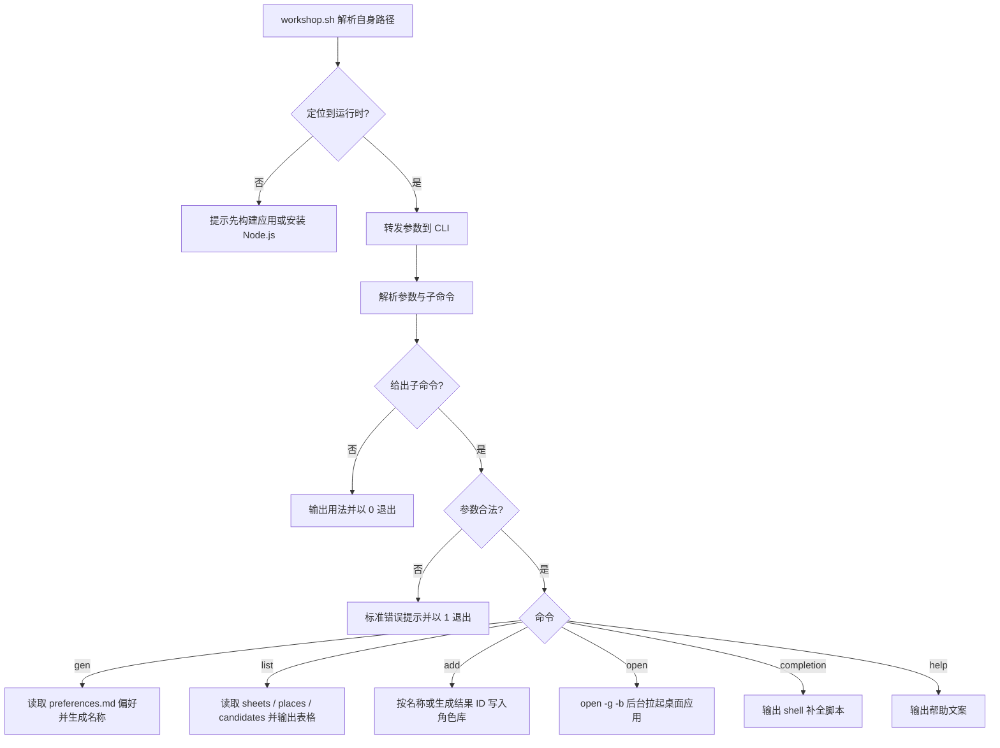

# 10. 命令行工具

### 10.1 定位与入口

命令行工具是桌面应用的附属入口：只提供「生成名称、查看项目数据、把名称写回角色库、拉起应用、输出命令补全脚本」这几件事，不复刻桌面应用的完整界面。

- 入口脚本：`runtime/workshop.sh`（POSIX shell）。脚本本身**只负责拉起工具**：解析自身真实路径（软连接指向时同样有效）、定位可用运行时、把命令行参数原样转发；参数解析、命令分发与结果输出全部在命令行工具内部完成。
- 业务实现：`src/cli/`，构建为单文件 CommonJS `release/cli/cli.cjs`（`vite.config.cli.ts`）。
- 运行时目录：仓库内为 `runtime/`；打包后随应用安装在 `Creation Workshop.app/Contents/Resources/runtime`（electron-builder `extraResources`）。
- 命令名：`workshop`。pkg 安装完成后在 PATH 可达的目录建立名为 `workshop` 的软连接指向 `runtime/workshop.sh`（见 §10.9）。

命令行工具与桌面应用共享同一份生成引擎（`src/lib/generator.ts`）、同一份项目数据（`.workshop`）与**同一份数据服务**（`WorkshopStorage`）：CLI 不自行解析 Markdown，所有读写都调用数据服务完成，因此两端的数据格式、写入规则与派生文件（`graph.md`、`sheets.ini`）完全一致。

### 10.2 运行形态

`runtime/workshop.sh` 按顺序探测可用运行时，命中即转发参数：

| 顺序 | 运行时           | 触发条件                                                      | 说明                              |
| ---- | ---------------- | ------------------------------------------------------------- | --------------------------------- |
| 1    | 已安装的桌面应用 | `<runtime>/../../MacOS/Creation Workshop` 可执行              | 以 `--cli` 参数启动应用，只跑 CLI |
| 2    | Node.js          | `release/cli/cli.cjs` 存在且 PATH 中有 `node`                 | 直接运行构建产物                  |
| 3    | 开发态 Electron  | `node_modules/electron/dist/Electron.app/.../Electron` 可执行 | 以 `<仓库> --cli` 启动            |
| —    | 报错退出         | 以上均不满足                                                  | 提示先构建应用或安装 Node.js      |

桌面应用以 `--cli` 启动时（`src/electron/main.cts`）：不创建窗口与托盘、不占用单实例锁、不注册系统协议、不初始化 IPC，执行完 CLI 后按 CLI 的退出码退出；因此桌面应用正在运行时 CLI 仍可正常使用。

CLI 的入口函数 `runCli(argv)` 返回 `Promise<number>`（退出码）：CLI 需要异步读写项目数据，主进程以 `app.exit(退出码)` 结束进程。

### 10.3 命令与参数

**必须给出至少一个子命令**：直接运行 `workshop`（不带子命令）只输出用法（退出码 `0`），不做任何生成或读写。

| 命令                 | 说明                                             | 等价开关      |
| -------------------- | ------------------------------------------------ | ------------- |
| `gen`                | 生成随机名称并以表格输出，输出含 ID              | —             |
| `list [类别]`        | 列出项目数据：设定卡 / 地名库 / 候选库           | `--list`      |
| `add [<ID>]`         | 把名称写入角色库：手动录入或收录 `gen` 输出的 ID | `--add`       |
| `open`               | 后台拉起桌面应用（仅 macOS，不抢前台）           | —             |
| `help [命令]`        | 显示帮助或某个命令的详细说明                     | `-h`/`--help` |
| `completion [shell]` | 输出 zsh / bash / fish 的命令补全脚本            | —             |

`list` 的类别参数（默认 `sheets`）：

| 类别         | 对应文件                  | 说明               |
| ------------ | ------------------------- | ------------------ |
| `sheets`     | `.workshop/sheets.md`     | 设定卡（默认）     |
| `places`     | `.workshop/places.md`     | 地名库             |
| `candidates` | `.workshop/candidates.md` | 候选库（人名候选） |

兼容旧用法：`list` 未显式给出类别但传了 `--type` 时，人名映射到 `candidates`、地名映射到 `places`。

参数（`--flag value` 与 `--flag=value` 两种写法均可；中文别名与英文别名等价）：

| 参数                     | 取值                                                          | 说明                                 |
| ------------------------ | ------------------------------------------------------------- | ------------------------------------ |
| `--race`                 | 人族 / 精灵族 / 妖鬼 / 混血（`human` `elf` `yaogui` `mixed`） | 族群；`add` 时表示角色族群           |
| `--type`                 | 人名 / 地名（`person` `place`）                               | 名称类型；`add` 时表示写入哪个库     |
| `--gender`               | 不限 / 男性 / 女性 / 中性（`any` `male` `female` `neutral`）  | 「不限」与「混合」同义，即男女混合   |
| `--weight`               | 0–1                                                           | 姓氏稀有倾向：0 = 按人口，1 = 极稀有 |
| `--count`                | 1–100                                                         | 生成数量                             |
| `--name`                 | 文本                                                          | 角色名称；`add` 与 ID 二选一         |
| `--note`                 | 文本                                                          | 角色备注                             |
| `--favorite`             | 开关                                                          | 标记为收藏                           |
| `--dir`                  | 路径                                                          | 项目目录                             |
| `--color` / `--no-color` | 开关                                                          | 强制彩色 / 纯色输出                  |
| `--version`              | —                                                             | 输出版本号                           |

参数错误（未知选项、取值越界、缺少必填项）一律打印到标准错误并以退出码 `1` 结束，不生成任何数据。

### 10.4 默认值来源

未显式指定的参数按「命令行参数 > 项目偏好 > CLI 内置默认值」的顺序确定：

- 项目偏好取自 `.workshop/preferences.md` 的「生成规则」段（`generator` 键），由数据服务的 `preferencesGet('generator')` 读取，并用应用侧的 `normalizeGenPrefs` 归一化。
- 偏好中存在时生效的字段：族群（`race`）、名称类型（`types[0]`）、生成数量（`params.count`）、性别（`params.gender`）、姓氏权重（`params.surnameBias`，0–100 刻度）、短名块数、人名后缀、人名字数上下限、职业与特殊能力。
- 项目没有 `preferences.md`（或其中没有「生成规则」段）时，回落到 CLI 内置默认值：人族、人名、不限（男女混合）、姓氏权重 0.6、数量 10、短名 2–3 字混合、父名后缀、人名 4–8 字。
- 命令行参数始终优先于项目偏好。

### 10.5 生成规则与临时结果

`gen` 按 §2 的生成引擎组合名称，规则参数来自 §10.4 解析出的结果（不再固定写死）。

生成结果的每一行带一个 ID（如 `m5x8k2q_0`），并写入项目目录的 `.workshop/temp.md`：

- `temp.md` 只保留最近 3 个生成批次（`TEMP_MAX_BATCHES`），新批次在前；更早的结果会被丢弃。
- 每条记录保存 ID、名称、族群、类型、性别、稀有度、字数、结构与批次标识，格式与其它 `.workshop` Markdown 一致（`##` 分条、`- 字段: 值`）。
- `workshop add <ID>` 从 `temp.md` 查找该 ID 并收录到角色库：人名写入 `candidates.md`（来源为「生成」），地名写入 `places.md`；找不到时报错退出。

### 10.6 输出

表格列宽按显示宽度计算（中文按两列），表头加粗、行间用两个空格分隔，表头下方是 `-` 分隔线。

| 命令   | 列                                                                                                     |
| ------ | ------------------------------------------------------------------------------------------------------ |
| `gen`  | ID、名称、族群、类型、性别、稀有度、字数、结构                                                         |
| `list` | 设定卡：人物名、族群、性别、职业、籍贯、备注、关系、创建时间                                           |
| `list` | 地名库：名称、族群、备注、创建时间；候选库：名称、族群、类型、性别、稀有度、字数、来源、收藏、创建时间 |

- 名称、类型等为空时显示 `-`。
- `gen` 末尾输出汇总行「共 N 条（去重 M 条）；用 workshop add <ID> 收录」；去重数为 0 时不显示。
- `list` 首行输出数据来源文件路径（如「设定卡：<项目>/.workshop/sheets.md」）。
- 颜色仅在输出到终端时生效（`--color` / `--no-color` 可强制）；写入管道或文件时为纯文本。

退出码：`0` 成功（含只输出用法的情形）；`1` 参数错误、数据目录不存在、名称重复、生成结果 ID 不存在或未能生成任何名称。

### 10.7 角色库读写

CLI 操作的是**当前目录**（或 `--dir` 指定目录）下的 `.workshop` 目录，目录名来自 `creationWorkshop.project.dataDirName`（默认 `.workshop`）。所有读写都通过数据服务（`WorkshopStorage`）完成：

| 命令   | 行为                                                                                                      |
| ------ | --------------------------------------------------------------------------------------------------------- |
| `list` | 只读：按类别读取 `sheets.md` / `places.md` / `candidates.md` 并输出表格；目录不存在时报错，不创建任何文件 |
| `gen`  | 写：把本次生成结果写入 `temp.md`（目录不存在时创建 `.workshop`）                                          |
| `add`  | 写：按名称或生成结果 ID 向 `candidates.md` / `places.md` 写入一条记录                                     |

写入规则（与 §7.4 保持一致）：

- 记录格式、字段顺序与标签由数据服务统一序列化，CLI 与桌面应用产物完全一致。
- 同一族群下名称重复时报错退出，不写入文件。
- 写入候选或地名后，数据服务会同步刷新 `graph.md`（图谱快照）与 `sheets.ini`（设定集清单），因此 VS Code 插件能立即看到新增条目。
- CLI 不写入 `sheets.md`、`relations.md`、`project.md` 与 `preferences.md`。

### 10.8 命令补全

- 补全脚本随应用分发在 `runtime/completions/`：zsh 用 `_workshop`（需位于 `fpath`），bash 用 `workshop.bash`，fish 用 `workshop.fish`。
- pkg 安装脚本（`scripts/pkg-scripts/postinstall`）在安装时按登录用户的 shell 自动注册：zsh 复制到 `/usr/local/share/zsh/site-functions/_workshop`，bash 复制到 `/usr/local/etc/bash_completion.d/workshop`（目录不存在时跳过），fish 复制到 `~/.config/fish/completions/workshop.fish`；注册失败不影响安装。
- `workshop completion [zsh|bash|fish]` 输出对应脚本（省略 shell 时按 `$SHELL` 判断，默认 zsh），用于手动安装。

### 10.9 构建与安装

| 环节     | 位置 / 命令                                             | 说明                                                             |
| -------- | ------------------------------------------------------- | ---------------------------------------------------------------- |
| 构建     | `pnpm run build:cli`                                    | `vite build --config vite.config.cli.ts` → `release/cli/cli.cjs` |
| 类型检查 | `pnpm run typecheck`                                    | 追加 `tsconfig.cli.json`（Node 类型 + `@/*` 别名）               |
| 打包     | `package.json` → `build.files` / `build.extraResources` | `release/cli/**/*` 进 asar；`runtime/` 进 `Contents/Resources`   |
| 安装     | `scripts/pkg-scripts/postinstall`                       | 建立 `workshop` 软连接并注册命令补全                             |

安装脚本按 `/usr/local/bin`、`/opt/homebrew/bin` 的顺序尝试建立软连接（`ln -sfn`），成功即停止；两个目录都不可写时静默跳过，不影响安装。软连接指向 `Contents/Resources/runtime/workshop.sh`，因此应用升级后软连接依然有效。

### 10.10 命令分发流程

