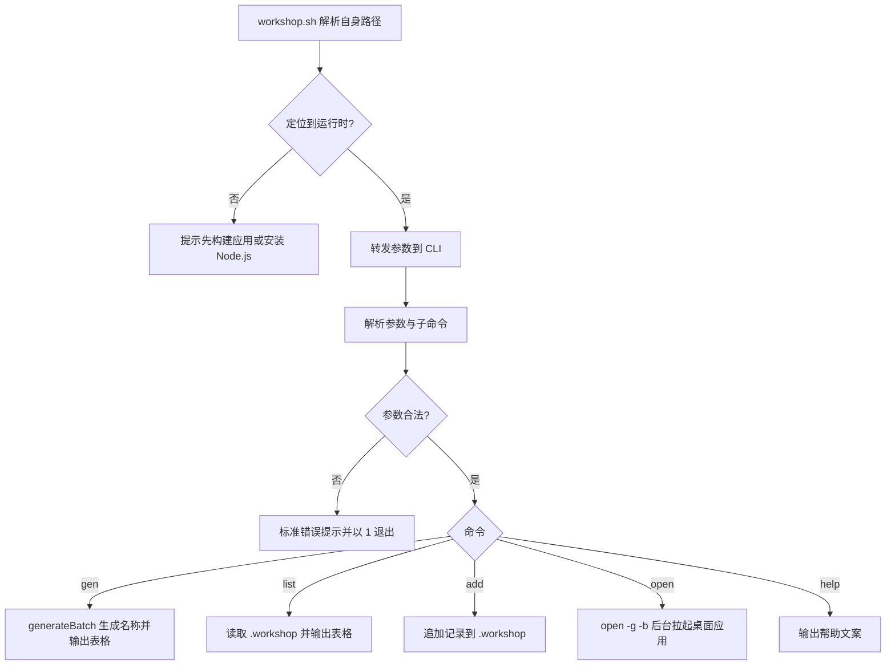

# 10. 命令行工具

### 10.1 定位与入口

命令行工具是桌面应用的附属入口：只提供「生成名称、查看角色库、把角色写回角色库、拉起应用」四件事，不复刻桌面应用的完整界面。

- 入口脚本：`runtime/workshop.sh`（POSIX shell）。脚本本身**只负责拉起工具**：解析自身真实路径（软连接指向时同样有效）、定位可用运行时、把命令行参数原样转发；参数解析、命令分发与结果输出全部在命令行工具内部完成。
- 业务实现：`src/cli/`，构建为单文件 CommonJS `release/cli/cli.cjs`（`vite.config.cli.ts`）。
- 运行时目录：仓库内为 `runtime/`；打包后随应用安装在 `Creation Workshop.app/Contents/Resources/runtime`（electron-builder `extraResources`）。
- 命令名：`workshop`。pkg 安装完成后在 PATH 可达的目录建立名为 `workshop` 的软连接指向 `runtime/workshop.sh`（见 §10.6）。

命令行工具与桌面应用共享同一份生成引擎（`src/lib/generator.ts`）与同一份项目数据（`.workshop`），因此两端生成的名称规则完全一致，CLI 写入的记录可被桌面应用直接读取。

### 10.2 运行形态

`runtime/workshop.sh` 按顺序探测可用运行时，命中即转发参数：

| 顺序 | 运行时           | 触发条件                                                      | 说明                              |
| ---- | ---------------- | ------------------------------------------------------------- | --------------------------------- |
| 1    | 已安装的桌面应用 | `<runtime>/../../MacOS/Creation Workshop` 可执行              | 以 `--cli` 参数启动应用，只跑 CLI |
| 2    | Node.js          | `release/cli/cli.cjs` 存在且 PATH 中有 `node`                 | 直接运行构建产物                  |
| 3    | 开发态 Electron  | `node_modules/electron/dist/Electron.app/.../Electron` 可执行 | 以 `<仓库> --cli` 启动            |
| —    | 报错退出         | 以上均不满足                                                  | 提示先构建应用或安装 Node.js      |

桌面应用以 `--cli` 启动时（`src/electron/main.cts`）：不创建窗口与托盘、不占用单实例锁、不注册系统协议，执行完 CLI 后按 CLI 的退出码退出；因此桌面应用正在运行时 CLI 仍可正常使用。

### 10.3 命令与参数

| 命令          | 说明                                    | 等价开关      |
| ------------- | --------------------------------------- | ------------- |
| `gen`（默认） | 生成随机名称并以表格输出                | —             |
| `list`        | 列出当前目录 `.workshop` 中的角色数据   | `--list`      |
| `add`         | 把角色写入当前目录 `.workshop` 的角色库 | `--add`       |
| `open`        | 后台拉起桌面应用（仅 macOS，不抢前台）  | —             |
| `help [命令]` | 显示帮助或某个命令的详细说明            | `-h`/`--help` |

参数（`--flag value` 与 `--flag=value` 两种写法均可；中文别名与英文别名等价）：

| 参数                     | 取值                                                          | 默认值   | 说明                                          |
| ------------------------ | ------------------------------------------------------------- | -------- | --------------------------------------------- |
| `--race`                 | 人族 / 精灵族 / 妖鬼 / 混血（`human` `elf` `yaogui` `mixed`） | 人族     | 族群；`--add` 时表示角色族群                  |
| `--type`                 | 人名 / 地名（`person` `place`）                               | 人名     | 名称类型；`--list` / `--add` 时表示读写哪个库 |
| `--gender`               | 不限 / 男性 / 女性 / 中性（`any` `male` `female` `neutral`）  | 不限     | 「不限」与「混合」同义，即男女混合            |
| `--weight`               | 0–1                                                           | 0.6      | 姓氏稀有倾向：0 = 按人口，1 = 极稀有          |
| `--count`                | 1–100                                                         | 10       | 生成数量                                      |
| `--name`                 | 文本                                                          | 空       | 角色名称；`--add` 必填                        |
| `--note`                 | 文本                                                          | 空       | 角色备注                                      |
| `--favorite`             | 开关                                                          | 否       | 标记为收藏                                    |
| `--dir`                  | 路径                                                          | 当前目录 | 项目目录                                      |
| `--color` / `--no-color` | 开关                                                          | 自动     | 强制彩色 / 纯色输出                           |
| `--version`              | —                                                             | —        | 输出版本号                                    |

参数错误（未知选项、取值越界、缺少必填项）一律打印到标准错误并以退出码 `1` 结束，不生成任何数据。

### 10.4 生成规则

CLI 直接调用 `generateBatch`（§2.3），规则参数固定为：

| 规则            | 取值                       | 来源                             |
| --------------- | -------------------------- | -------------------------------- |
| 短名块数        | 2–3 字混合                 | `shortMode: 'mix'`               |
| 人名后缀        | 父名                       | `personSuffix: 'father'`         |
| 人名全名字数    | 4–8                        | `minChars` / `maxChars`          |
| 职业 / 特殊能力 | 随机                       | `professions` / `abilities` 为空 |
| 姓氏权重        | `--weight` × 100，四舍五入 | `surnameBias`（§2.2）            |

`--weight` 是 0–1 的稀有倾向刻度，内部换算为应用使用的 0–100 姓氏权重：`0` = 按人口分布，`0.5` = 均衡（应用滑块 50），`1` = 极稀有（滑块 100）。默认 `0.6` 对应滑块 60（偏稀有）。

### 10.5 输出

表格列宽按显示宽度计算（中文按两列），表头加粗、行间用两个空格分隔，表头下方是 `-` 分隔线。

| 命令   | 列                                                                                                 |
| ------ | -------------------------------------------------------------------------------------------------- |
| `gen`  | 序号、名称、族群、类型、性别、稀有度、字数、结构                                                   |
| `list` | 名称、族群、类型、性别、稀有度、字数、来源、收藏、创建时间（地名库为：名称、族群、备注、创建时间） |

- 名称、类型等为空时显示 `-`。
- `gen` 末尾输出汇总行「共 N 条（去重 M 条）」；去重数为 0 时不显示。
- 颜色仅在输出到终端时生效（`--color` / `--no-color` 可强制）；写入管道或文件时为纯文本。

退出码：`0` 成功；`1` 参数错误、角色库不存在、名称重复或未能生成任何名称。

### 10.6 角色库读写

CLI 操作的是**当前目录**（或 `--dir` 指定目录）下的 `.workshop` 目录，目录名来自 `creationWorkshop.project.dataDirName`（默认 `.workshop`）。

| 命令   | 行为                                                                                                        |
| ------ | ----------------------------------------------------------------------------------------------------------- |
| `list` | 只读：解析 `.workshop/candidates.md`（`--type place` 时解析 `places.md`）并输出表格；目录或文件不存在时报错 |
| `add`  | 写：向 `.workshop/candidates.md`（`--type place` 时为 `places.md`）**追加**一条记录                         |

写入规则（与 §7.4 保持一致）：

- 追加而非重写整份文件，已有内容原样保留；文件不存在时先写入与主进程一致的表头再追加。
- 字段顺序、标签与时间格式与主进程序列化结果一致：`- ID:`（反引号包裹）、`- 名称:`、`- 族群:`、`- 类型:`、`- 性别:`、`- 字数:`、`- 来源: 手动`、`- 收藏:`、`- 备注:`、`- 创建时间:` / `- 更新时间:`（ISO 8601）。
- 新增记录 `来源` 固定为「手动」，`收藏` 由 `--favorite` 决定；`稀有度` 留空（手工名称没有姓氏权重信息）。
- 同一族群下名称重复时报错退出，不写入文件。
- 目录不存在时 `--add` 会创建 `.workshop` 目录（与桌面应用打开项目时的行为一致）；`--list` 不创建任何文件。

CLI 不写入 `sheets.md`、`relations.md`、`graph.md`、`sheets.ini` 与 `preferences.md`；其中 `sheets.ini` 与图谱快照由桌面应用下次打开项目时重建。

### 10.7 构建与安装

| 环节     | 位置 / 命令                                             | 说明                                                             |
| -------- | ------------------------------------------------------- | ---------------------------------------------------------------- |
| 构建     | `pnpm run build:cli`                                    | `vite build --config vite.config.cli.ts` → `release/cli/cli.cjs` |
| 类型检查 | `pnpm run typecheck`                                    | 追加 `tsconfig.cli.json`（Node 类型 + `@/*` 别名）               |
| 打包     | `package.json` → `build.files` / `build.extraResources` | `release/cli/**/*` 进 asar；`runtime/` 进 `Contents/Resources`   |
| 安装     | `scripts/pkg-scripts/postinstall`                       | 在 PATH 可达目录建立 `workshop` 软连接                           |

安装脚本按 `/usr/local/bin`、`/opt/homebrew/bin` 的顺序尝试建立软连接（`ln -sfn`），成功即停止；两个目录都不可写时静默跳过，不影响安装。软连接指向 `Contents/Resources/runtime/workshop.sh`，因此应用升级后软连接依然有效。

### 10.8 命令分发流程

